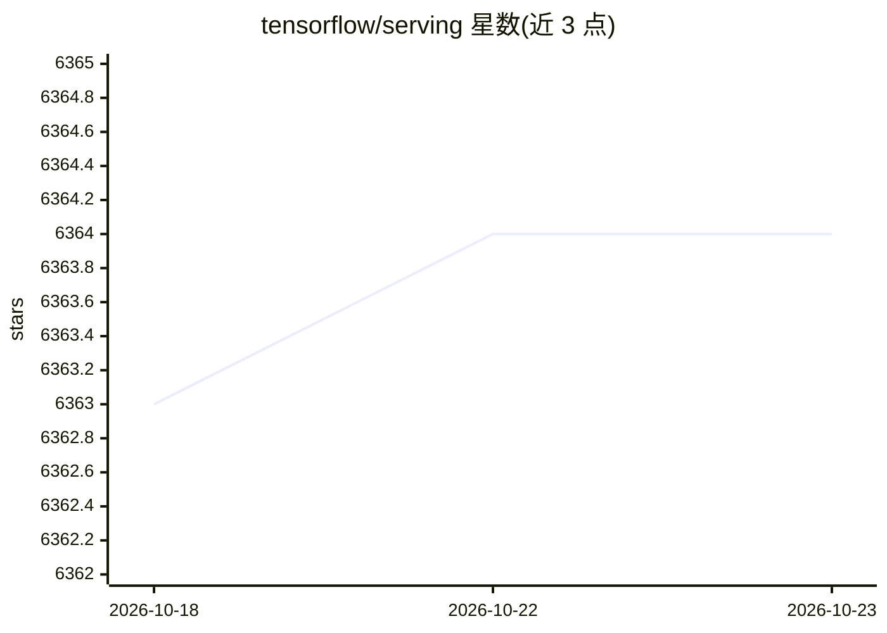

# tensorflow/serving

⭐ 6,364 · C++ · Apache-2.0 · 推送 2026-10-21 · [GitHub](https://github.com/tensorflow/serving) · [官网](https://www.tensorflow.org/serving) · 组织维护

**面向生产环境的机器学习模型推理服务系统**

TensorFlow 官方维护的模型 serving 系统：在模型训练完成后接管其生命周期管理，通过版本化的引用计数查找表向客户端提供模型访问，暴露 gRPC 与 HTTP 推理端点。开箱支持 TensorFlow SavedModel，可通过自定义 Servable 扩展到非 TensorFlow 模型。提供多模型多版本同时服务、新版本灰度与 A/B 测试、请求批处理调度等能力。推荐以 Docker 镜像方式安装，也可无 Docker 安装或从源码构建，支持 Kubernetes 部署。

## 筛选速览

| 维度 | 判定 | 备注 |
|---|---|---|
| AI 角色 | `ai-ecosystem` | LLM/agent 周边工具 |
| 许可风险 | `permissive` | Apache-2.0 |
| 部署形态 | `self-host` | docker 或自建部署 |
| 模型依赖 | — | README 未给出锁定关系 |
| 硬件要求 | — | 无带数字的原话,不猜 |
| 安装摩擦 | `low` | 无编译、无系统依赖或容器化 |
| 成熟度 | — | 结构信号不足 |

## 能力要点

- 同时服务多个模型或同一模型的多个版本
- 暴露 gRPC 与 HTTP 推理端点
- 新版本部署无需修改客户端代码，支持灰度与 A/B 测试
- 调度器将推理请求合并批次在 GPU 上联合执行

## 适用场景

- 生产环境部署和管理训练好的模型
- 模型版本迭代时进行灰度发布与 A/B 测试
- 在 Kubernetes 上运行模型推理服务

## 场景标签

`推理引擎` · 领域:训练与推理

## 证据(README 行号)

> L8: TensorFlow Serving is a flexible, high-performance serving system for
> L10: the *inference* aspect of machine learning, taking models after *training* and

## 星数曲线

2026-10-18 6,363 → 2026-10-23 6,364（+1）

---
*卡片 v1 · prompt 1.4 · 生成 2026-10-20 · 置信度 high · 依据 README sha `d846690572ce` · [字段定义](../../DATASET.md)*
