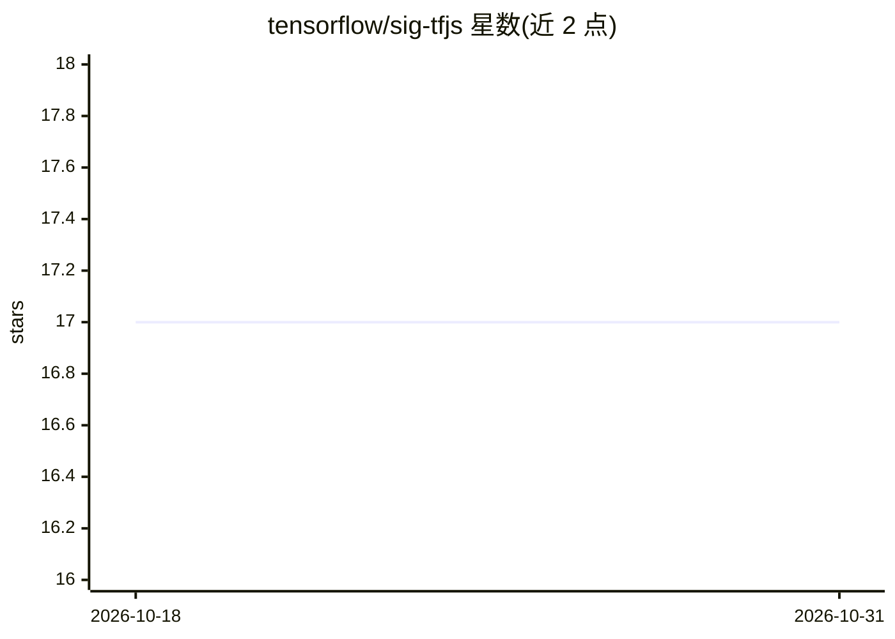

# tensorflow/sig-tfjs

⭐ 17 · TypeScript · Apache-2.0 · 推送 2026-10-29 · [GitHub](https://github.com/tensorflow/sig-tfjs) · 组织维护

**TensorFlow.js SIG 的社区协作仓库**

TensorFlow.js 特别兴趣小组（SIG）的社区仓库，用于承载 TFJS SIG 相关项目。README 仅说明其为社区项目仓库，未描述具体功能、安装方式或使用方法，属于组织协作用途而非独立可安装产品。

## 筛选速览

| 维度 | 判定 | 备注 |
|---|---|---|
| AI 角色 | `ai-ecosystem` | LLM/agent 周边工具 |
| 许可风险 | `permissive` | Apache-2.0 |
| 部署形态 | `None` |  |
| 模型依赖 | — | README 未给出锁定关系 |
| 硬件要求 | — | 无带数字的原话,不猜 |
| 安装摩擦 | `low` | 无编译、无系统依赖或容器化 |
| 成熟度 | — | 结构信号不足 |

## 能力要点

- TensorFlow.js SIG 官方社区仓库
- 用于承载 SIG 相关项目

## 适用场景

- 查找 TFJS SIG 社区维护的项目

## 场景标签

 · 领域:机器学习生态/社区协作

## 证据(README 行号)

> L1: # TensorFlow.JS SIG repo
> L3: A community repo for TFJS SIG projects.

## 星数曲线

2026-10-18 17 → 2026-10-31 17（+0）

---
*卡片 v1 · prompt 1.4 · 生成 2026-10-29 · 置信度 low · 依据 README sha `7f2b5cd2a13d` · [字段定义](../../DATASET.md)*
