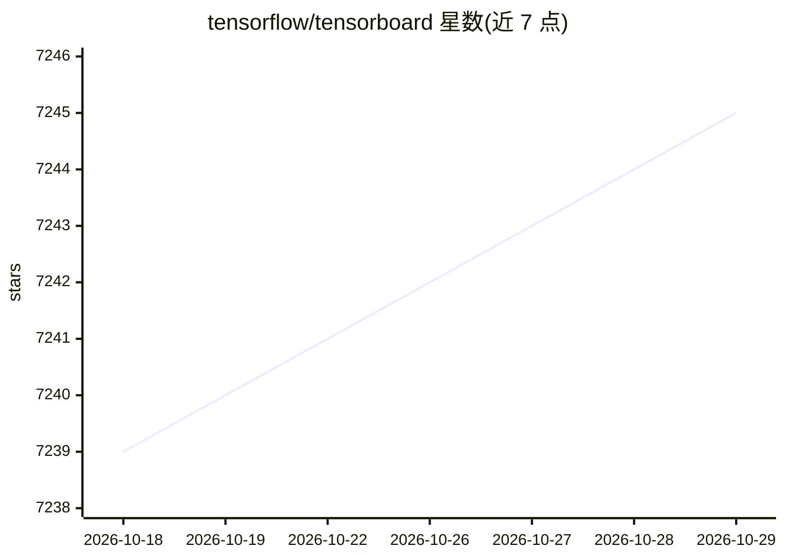

# tensorflow/tensorboard

⭐ 7,245 · TypeScript · Apache-2.0 · 推送 2026-10-26 · [GitHub](https://github.com/tensorflow/tensorboard) · 组织维护

**给 TensorFlow 用户的训练可视化工具：检查运行与计算图**

TensorBoard 是一组 Web 应用，用于检查和理解 TensorFlow 的运行记录与计算图。它通过 summary ops 将 scalar/image/audio/text/histogram 等数据以 protobuf 形式写入 logdir 下的 tfevents 事件文件，TensorBoard 读取整个目录并将多个事件文件拼接为一致的执行历史。提供标量、直方图、分布、图像、音频、图浏览器、Embedding Projector、文本与时间序列等面板，支持多 run 对比。可完全离线运行，经 pip 安装后以 tensorboard --logdir 启动并访问 localhost:6006；Chrome/Firefox 为可用浏览器。

## 筛选速览

| 维度 | 判定 | 备注 |
|---|---|---|
| AI 角色 | `ai-ecosystem` | LLM/agent 周边工具 |
| 许可风险 | `permissive` | Apache-2.0 |
| 部署形态 | `library` | 以包/库形式分发 |
| 模型依赖 | — | README 未给出锁定关系 |
| 硬件要求 | — | 无带数字的原话,不猜 |
| 安装摩擦 | `low` | 无编译、无系统依赖或容器化 |
| 成熟度 | — | 结构信号不足 |

## 能力要点

- 读取 logdir 下 tfevents 事件文件，自动拼接多文件为一致历史
- 多 run 对比：递归遍历子目录加载为不同 run
- 面板覆盖标量/直方图/分布/图像/音频/图/嵌入投影/文本/时间序列
- 设计为完全离线运行，无需访问 Internet

## 适用场景

- 训练过程中跟踪 loss、学习率等标量曲线并对比多次实验
- 检查 TensorFlow 模型计算图结构
- 可视化高维嵌入与训练样本图像、音频、文本

## 场景标签

`MLOps` · 领域:训练与推理

## 证据(README 行号)

> L3: TensorBoard is a suite of web applications for inspecting and understanding your
> L19: Before running TensorBoard, make sure you have generated summary data in a log
> L30: Once you have event files, run TensorBoard and provide the log directory. If

## 星数曲线

2026-10-18 7,239 → 2026-10-29 7,245（+6）

---
*卡片 v1 · prompt 1.4 · 生成 2026-10-20 · 置信度 high · 依据 README sha `71c0b62d2165` · [字段定义](../../DATASET.md)*
