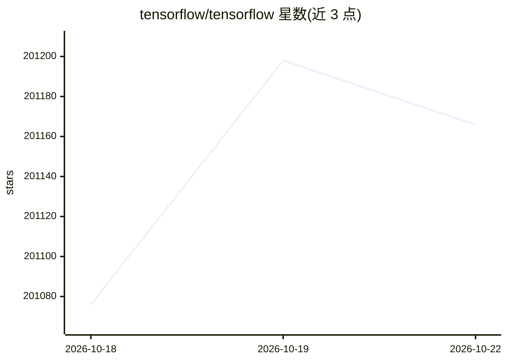

# tensorflow/tensorflow

⭐ 201,179 · C++ · Apache-2.0 · 推送 2026-10-22 · [GitHub](https://github.com/tensorflow/tensorflow) · [官网](https://tensorflow.org) · 组织维护

**面向研究者与开发者的端到端开源机器学习平台**

端到端开源机器学习平台，提供工具、库与社区资源，供研究者推进 ML 研究并让开发者构建和部署 ML 应用。最初由 Google Brain 机器智能团队的研究者与工程师开发。提供稳定的 Python 与 C++ API，并为其他语言提供非保证向后兼容的 API。通过 pip 安装，含 CUDA GPU 支持包与 CPU-only 精简包，另有 nightly 测试包与 Docker 容器、源码构建途径。

## 筛选速览

| 维度 | 判定 | 备注 |
|---|---|---|
| AI 角色 | `ai-ecosystem` | LLM/agent 周边工具 |
| 许可风险 | `permissive` | Apache-2.0 |
| 部署形态 | `library` | 以包/库形式分发 |
| 模型依赖 | — | README 未给出锁定关系 |
| 硬件要求 | `cpu-ok` | |
| 安装摩擦 | `medium` | 含编译或系统依赖之一 |
| 成熟度 | — | 结构信号不足 |

## 动量与使用信号

- 维护:`active` — 距上次 push 0.6 天,年发版 4,411 位贡献者
- 涨星:近 1 天 **+16**(自 20261016 起算)
- 安装:pypi 包 `tensorflow` 月下载 11,902,358
- 平台:WINDOWS / MACOS / LINUX · 协议:—

## 能力要点

- 端到端机器学习平台，含工具、库与社区资源生态
- 稳定 Python 与 C++ API，其他语言 API 非保证向后兼容
- pip 安装含 GPU（CUDA）包 tensorflow 与 CPU-only 包 tensorflow-cpu
- 官方构建覆盖 Linux/macOS/Windows/Android(LiteRT)/树莓派

## 适用场景

- 训练与部署机器学习/深度神经网络模型
- 在 Ubuntu/Windows 上使用 CUDA GPU 加速训练
- 在 Android 或树莓派等平台部署模型

## 场景标签

`模型训练` `推理引擎` · 领域:训练与推理

## 证据(README 行号)

> L15: TensorFlow is an end-to-end open source platform
> L28: TensorFlow provides stable Python

## 星数曲线

2026-10-18 201,076 → 2026-10-22 201,166（+90）

---
*卡片 v1 · prompt 1.4 · 生成 2026-10-18 · 置信度 high · 依据 README sha `0397f17f6156` · [字段定义](../../DATASET.md)*
