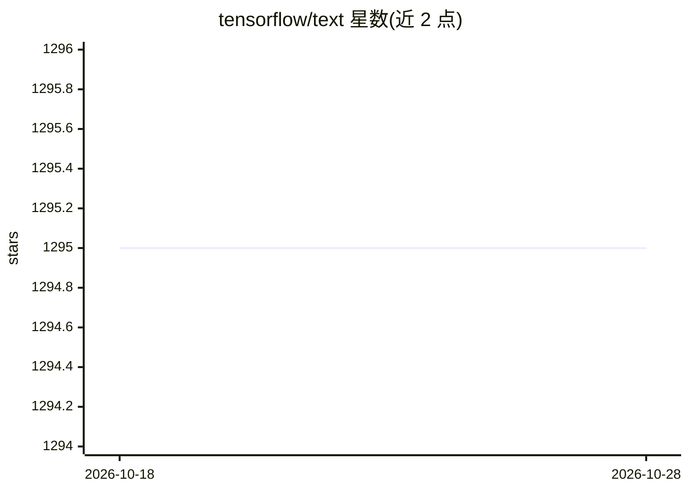

# tensorflow/text

⭐ 1,295 · C++ · Apache-2.0 · 推送 2026-10-28 · [GitHub](https://github.com/tensorflow/text) · [官网](https://www.tensorflow.org/beta/tutorials/tensorflow_text/intro) · 组织维护

**TensorFlow 官方文本预处理算子库，供 TF2 文本模型使用**

TensorFlow 团队维护的 Python 库，提供在 TensorFlow 图内执行的文本处理算子：UTF-8 转码、大小写折叠与 NFKC/NFKD 规范化、Whitespace/UnicodeScript 等分词器（返回 RaggedTensor 并可给出字节偏移）、wordshape 正则特征、N-gram 滑窗等，兼容 tf.data 与 Keras。给使用 TensorFlow 2.x 构建文本模型的开发者使用。限制：2.10 版后官方 pip 包仅覆盖 Linux x86_64 与 Intel Mac，Windows/Aarch64 需自行构建；版本须与 TensorFlow 主次版本对应。

## 筛选速览

| 维度 | 判定 | 备注 |
|---|---|---|
| AI 角色 | `ai-ecosystem` | LLM/agent 周边工具 |
| 许可风险 | `permissive` | Apache-2.0 |
| 部署形态 | `self-host` | docker 或自建部署 |
| 模型依赖 | — | README 未给出锁定关系 |
| 硬件要求 | — | 无带数字的原话,不猜 |
| 安装摩擦 | `low` | 无编译、无系统依赖或容器化 |
| 成熟度 | — | 结构信号不足 |

## 能力要点

- 分词在 TensorFlow 图内执行，训练与推理预处理一致
- TokenizerWithOffsets 提供词元到原串的字节偏移
- 提供 Unicode 规范化（NFKC/NFKD）与大小写折叠算子
- wordshape 正则特征与 N-gram/滑窗算子，兼容 tf.data 与 Keras

## 适用场景

- 在 TensorFlow 2.x 模型中做统一的训练/推理文本预处理
- 对多语言（含中文等无空格语言）做基于 Unicode 脚本的分词
- 获取词元偏移用于溯源或高亮场景
- 构建需要规范化与 wordshape 特征的 NLU 模型

## 场景标签

 · 领域:NLP/机器学习库

## 证据(README 行号)

> L20: TensorFlow Text provides a collection of text related classes and ops ready to
> L26: in the TensorFlow graph. You do not need to worry about tokenization in

## 星数曲线

2026-10-18 1,295 → 2026-10-28 1,295（+0）

---
*卡片 v1 · prompt 1.4 · 生成 2026-10-21 · 置信度 mid · 依据 README sha `6845fcc60426` · [字段定义](../../DATASET.md)*
