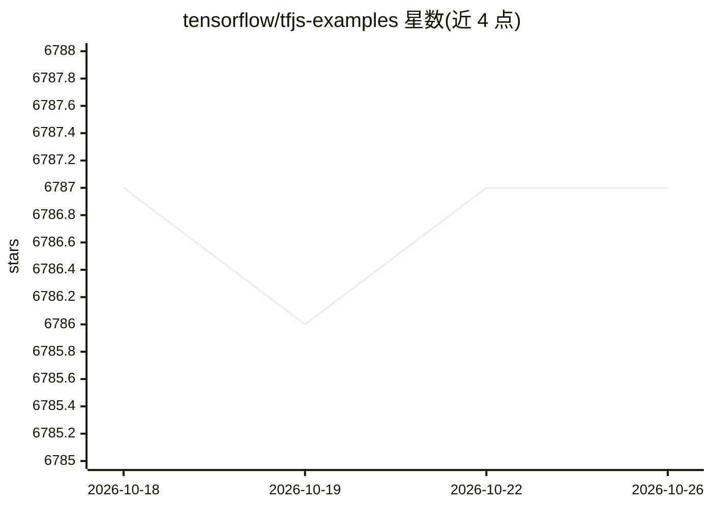

# tensorflow/tfjs-examples

⭐ 6,787 · JavaScript · Apache-2.0 · 推送 2026-09-22 · [GitHub](https://github.com/tensorflow/tfjs-examples) · [官网](https://js.tensorflow.org/) · 组织维护

**TensorFlow.js 官方示例集：浏览器/Node.js 中的训练与推理**

TensorFlow.js 官方维护的示例集合，含 40 余个独立示例目录，覆盖图像分类（MNIST、MobileNet）、目标检测、文本生成（LSTM）、序列到序列翻译、情感分析、强化学习（DQN、cart-pole）、生成模型（GAN、VAE）与迁移学习等任务。每条示例以表格标注数据类型、模型结构、运行环境（浏览器或 Node.js）及保存/加载方式，目录可单独复制到其他项目。构建依赖 Node.js 8.9+ 与 npm/yarn，通过 watch 脚本本地运行。

## 筛选速览

| 维度 | 判定 | 备注 |
|---|---|---|
| AI 角色 | `ai-knowledge` | 知识聚合/清单类 |
| 许可风险 | `permissive` | Apache-2.0 |
| 部署形态 | `library` | 以包/库形式分发 |
| 模型依赖 | — | README 未给出锁定关系 |
| 硬件要求 | — | 无带数字的原话,不猜 |
| 安装摩擦 | `low` | 无编译、无系统依赖或容器化 |
| 成熟度 | — | 结构信号不足 |

## 能力要点

- 40+ 独立示例覆盖图像、文本、时序、强化学习与生成模型任务
- 每个示例标注模型类型、训练/推理环境与保存加载方式
- 示例目录可独立复制到其他项目
- 提供 watch（本地开发）与 build（部署产物）两种脚本约定

## 适用场景

- 学习在浏览器或 Node.js 中训练和推理模型
- 查找迁移学习、WebGL 推理等具体场景的参考代码
- 将示例目录复制到自己的项目中起步

## 场景标签

`教程课程` · 领域:学习与行业

## 证据(README 行号)

> L1: # TensorFlow.js Examples
> L3: This repository contains a set of examples implemented in
> L11:  Example name

## 星数曲线

2026-10-18 6,787 → 2026-10-26 6,787（+0）

---
*卡片 v1 · prompt 1.4 · 生成 2026-10-20 · 置信度 high · 依据 README sha `700684d7bdaf` · [字段定义](../../DATASET.md)*
