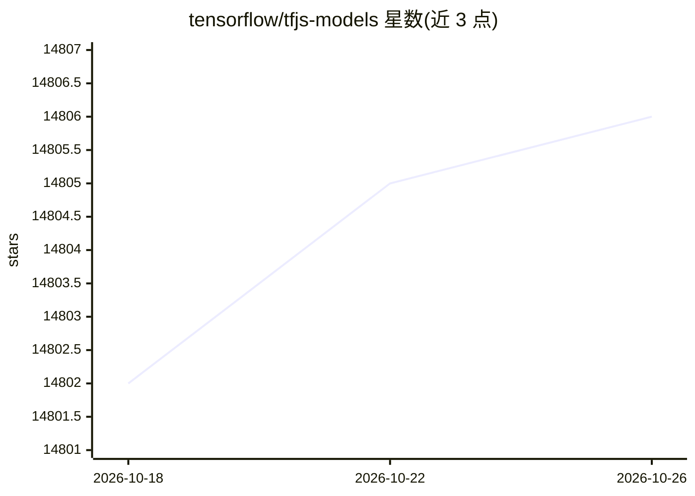

# tensorflow/tfjs-models

⭐ 14,806 · TypeScript · Apache-2.0 · 推送 2026-06-23 · [GitHub](https://github.com/tensorflow/tfjs-models) · [官网](https://js.tensorflow.org) · 组织维护

**前端开发者在浏览器中运行 TensorFlow.js 预训练模型集合**

托管一组已移植到 TensorFlow.js 的预训练模型，发布在 NPM 与 unpkg 上，可直接使用或在 TensorFlow.js 中做迁移学习。涵盖图像分类、手部/人体姿态检测、目标检测、语义分割、人脸关键点、语音命令分类、文本编码与毒性评分、人像深度估计，另附 KNN 分类器等通用工具。API 设计上隐藏张量细节，面向非机器学习专家，每个模型有独立目录与 README。

## 筛选速览

| 维度 | 判定 | 备注 |
|---|---|---|
| AI 角色 | `ai-ecosystem` | LLM/agent 周边工具 |
| 许可风险 | `permissive` | Apache-2.0 |
| 部署形态 | `library` | 以包/库形式分发 |
| 模型依赖 | — | README 未给出锁定关系 |
| 硬件要求 | — | 无带数字的原话,不猜 |
| 安装摩擦 | `low` | 无编译、无系统依赖或容器化 |
| 成熟度 | — | 结构信号不足 |

## 动量与使用信号

- 维护:`maintenance` — 距上次 push 116.6 天,年发版 0,97 位贡献者
- 涨星:近 1 天 **+0**(自 20261016 起算)
- 安装:npm 包 `@tensorflow-models/mobilenet` 月下载 58,449

## 能力要点

- 提供 MobileNet 图像分类、Coco SSD 目标检测、DeepLab v3 语义分割等图像模型
- 支持浏览器端实时手部/人体姿态检测与 3D 人脸关键点检测
- 包含语音命令分类、文本编码/毒性评分、人像深度估计
- 提供 KNN 分类器工具包，支持迁移学习场景

## 适用场景

- 在网页中做图像分类或目标检测
- 浏览器端实时人体/手部姿态与面部关键点检测
- 为文本任务生成句向量或给评论打毒性分
- 基于预训练模型做迁移学习构建自定义应用

## 场景标签

`目标检测` · 领域:感知与多模态

## 证据(README 行号)

> L3: This repository hosts a set of pre-trained models that have been ported to
> L6: The models are hosted on NPM and unpkg so they can be used in any project out of the box. They can be used directly 
> L11: non-machine learning experts.

## 星数曲线

2026-10-18 14,802 → 2026-10-26 14,806（+4）

---
*卡片 v1 · prompt 1.4 · 生成 2026-10-18 · 置信度 high · 依据 README sha `ebc280b02502` · [字段定义](../../DATASET.md)*
