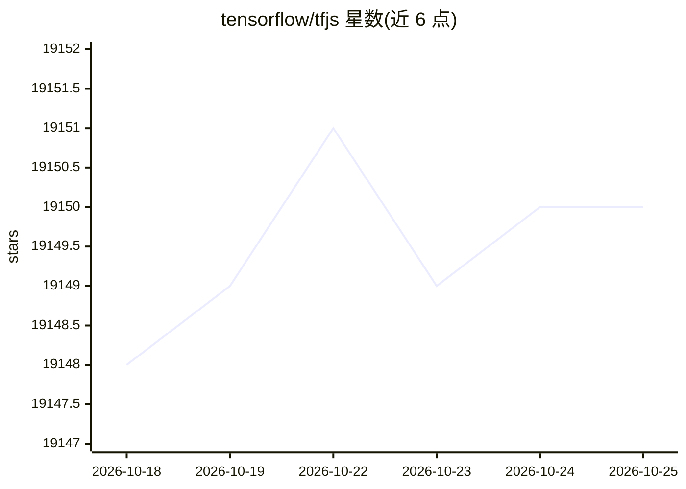

# tensorflow/tfjs

⭐ 19,150 · TypeScript · Apache-2.0 · 推送 2026-06-23 · [GitHub](https://github.com/tensorflow/tfjs) · [官网](https://js.tensorflow.org) · 组织维护

**在浏览器与 Node.js 中训练和部署机器学习模型的 JS 库**

TensorFlow.js 是硬件加速的 JavaScript 库，支持在浏览器和 Node.js 中训练与部署机器学习模型。仓库组合多个包：Core（底层计算）、Layers（类似 Keras 的高层 API）、Data（数据加载）、Converter（导入 TensorFlow SavedModel）、Vis（浏览器内可视化）、AutoML（加载 AutoML Edge 模型）。后端覆盖 CPU、WebGL、WASM、WebGPU、Node.js 与 React Native。安装方式为 script 标签或 npm/yarn，并支持从 TensorFlow SavedModel 与 Keras 迁移预训练模型。

## 筛选速览

| 维度 | 判定 | 备注 |
|---|---|---|
| AI 角色 | `ai-ecosystem` | LLM/agent 周边工具 |
| 许可风险 | `permissive` | Apache-2.0 |
| 部署形态 | `None` |  |
| 模型依赖 | — | README 未给出锁定关系 |
| 硬件要求 | — | 无带数字的原话,不猜 |
| 安装摩擦 | `low` | 无编译、无系统依赖或容器化 |
| 成熟度 | — | 结构信号不足 |

## 动量与使用信号

- 维护:`maintenance` — 距上次 push 117.4 天,年发版 0,341 位贡献者
- 涨星:近 1 天 **+0**(自 20261016 起算)

## 能力要点

- 浏览器内训练与部署模型，支持 WebGL/WASM/WebGPU/CPU 多后端
- 提供模型转换器导入 TensorFlow SavedModel 与 Keras 模型
- Layers API 实现类似 Keras 的高层功能，可按需单独导入包
- 预训练模型通过 NPM 上的 models 仓库提供

## 适用场景

- 在网页中训练或运行机器学习模型而无需服务器端推理
- 将已有 TensorFlow/Keras 模型迁移到浏览器运行
- 在 Node.js 环境用同一 API 执行原生 TensorFlow
- 用浏览器连接的传感器数据在客户端重训练模型

## 场景标签

`模型训练` `推理引擎` · 领域:训练与推理

## 证据(README 行号)

> L3: TensorFlow.js is an open-source hardware-accelerated JavaScript library for
> L44: Backends/Platforms:
> L78: There are two main ways to get TensorFlow.js in your JavaScript project:

## 星数曲线

2026-10-18 19,148 → 2026-10-25 19,150（+2）

---
*卡片 v1 · prompt 1.4 · 生成 2026-10-18 · 置信度 high · 依据 README sha `822ad4ac8464` · [字段定义](../../DATASET.md)*
