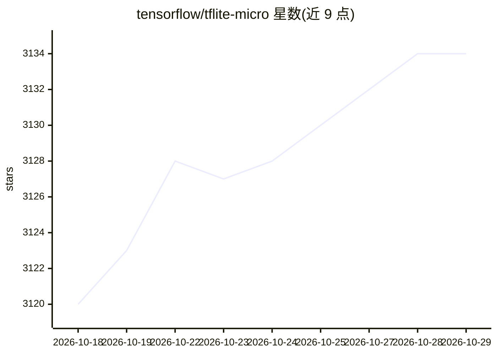

# tensorflow/tflite-micro

⭐ 3,134 · C++ · Apache-2.0 · 推送 2026-10-28 · [GitHub](https://github.com/tensorflow/tflite-micro) · 组织维护

**在微控制器等低功耗嵌入式设备上运行深度学习模型的推理框架**

TensorFlow Lite for Microcontrollers（TFLM）提供在裸机系统、DSP 与仅有数十至数百 KB 内存的微控制器上运行深度学习模型的基础设施，运行经 LiteRT 与 TensorFlow 转换的模型。支持经 CI 测试的一级架构（Arm Cortex-M、Cadence Xtensa、RISC-V、Qualcomm Hexagon、x86/Windows）及 Arduino、ESP32 等社区平台，提供内存管理、优化内核移植、模型压缩与 Python 解释器等文档。以 C++ 核心与 PyPI 包形式分发，面向嵌入式开发。

## 筛选速览

| 维度 | 判定 | 备注 |
|---|---|---|
| AI 角色 | `ai-ecosystem` | LLM/agent 周边工具 |
| 许可风险 | `permissive` | Apache-2.0 |
| 部署形态 | `library` | 以包/库形式分发 |
| 模型依赖 | — | README 未给出锁定关系 |
| 硬件要求 | — | 无带数字的原话,不猜 |
| 安装摩擦 | `low` | 无编译、无系统依赖或容器化 |
| 成熟度 | — | 结构信号不足 |

## 能力要点

- 面向数十至数百 KB 内存限制的裸机/DSP/微控制器设备
- CI 测试覆盖 Cortex-M、Xtensa、RISC-V、Hexagon、x86/Windows
- 支持 Arduino、ESP32、Renesas 等社区平台
- 提供模型压缩指南与 Python 解释器

## 适用场景

- 在微控制器上部署已转换的深度学习模型做推理
- 为新的嵌入式平台移植优化的算子内核
- 对嵌入式模型做压缩与基准测试

## 场景标签

`推理引擎` · 领域:训练与推理

## 证据(README 行号)

> L12: TensorFlow Lite for Microcontrollers is designed to run deep learning models on bare-metal systems, DSPs, and micro
> L16: * **Tier-1 Architectures (Tested in CI):** Arm Cortex-M (CMSIS-NN / Corstone), Cadence Xtensa (HiFi 3/4/5, Vision P

## 星数曲线

2026-10-18 3,120 → 2026-10-29 3,134（+14）

---
*卡片 v1 · prompt 1.4 · 生成 2026-10-20 · 置信度 high · 依据 README sha `9e464817c1b0` · [字段定义](../../DATASET.md)*
