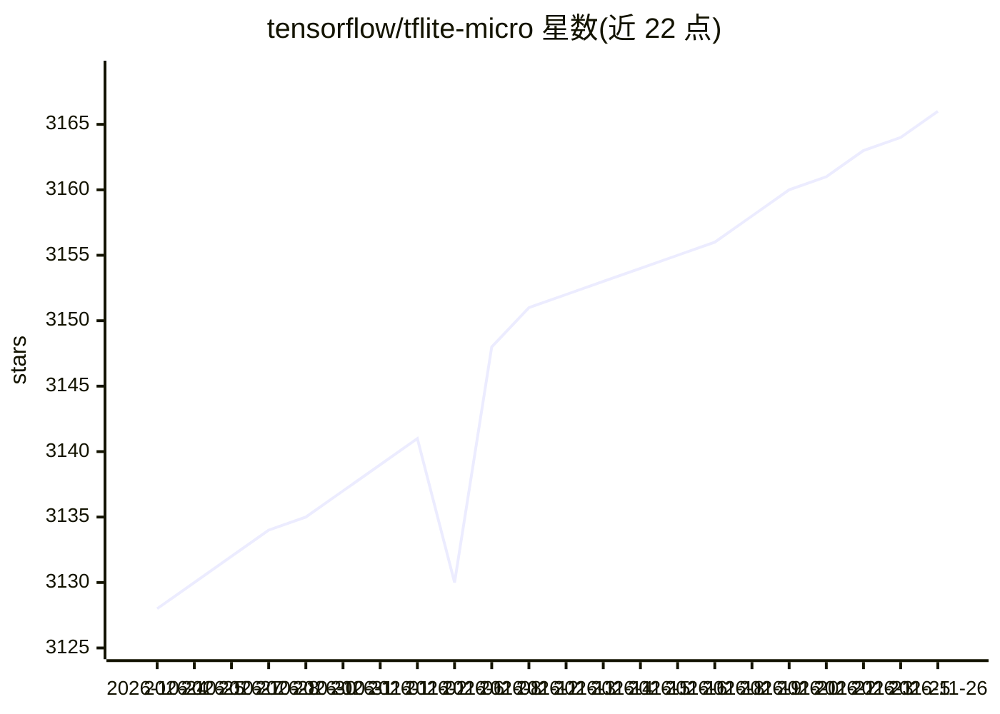

# tensorflow/tflite-micro

⭐ 3,166 · C++ · Apache-2.0 · 推送 2026-11-24 · [GitHub](https://github.com/tensorflow/tflite-micro) · 组织维护

**在微控制器等资源受限嵌入式设备上运行深度学习模型的推理框架**

TensorFlow Lite for Microcontrollers 面向内存仅数十至数百 KB 的裸机系统、DSP 与微控制器，运行经 LiteRT/TensorFlow 转换的深度学习模型。提供 Python 解释器、模型压缩工具、逐层调试工具与基准/性能分析工具，并给出移植到新平台的文档。CI 中测试的 Tier-1 架构包括 Arm Cortex-M（CMSIS-NN/Corstone）、Cadence Xtensa、Qualcomm Hexagon 与 x86/Windows，另有 Arduino、ESP32 等社区平台与 SDK 支持。

## 筛选速览

| 维度 | 判定 | 备注 |
|---|---|---|
| AI 角色 | `ai-native` | 本体是模型或模型工具 |
| 许可风险 | `permissive` | Apache-2.0 |
| 部署形态 | `library` | 以包/库形式分发 |
| 模型依赖 | — | README 未给出锁定关系 |
| 硬件要求 | — | 无带数字的原话,不猜 |
| 安装摩擦 | `low` | 无编译、无系统依赖或容器化 |
| 成熟度 | — | 结构信号不足 |

## 能力要点

- 在 tens 至数百 KB 内存限制的裸机系统/DSP/微控制器上运行深度学习模型
- Tier-1 架构经 CI 测试：Arm Cortex-M、Xtensa、Hexagon、x86/Windows
- 提供 Python 解释器、模型压缩教程、逐层调试与性能分析工具

## 适用场景

- 在微控制器项目上部署已训练好的模型进行推理
- 将模型移植到 ESP32/Arduino 等社区平台
- 对嵌入式端模型做压缩、调试与性能分析

## 场景标签

`推理引擎` `模型量化` · 领域:训练与推理

## 证据(README 行号)

> L11: TensorFlow Lite for Microcontrollers is designed to run deep learning models on bare-metal systems, DSPs, and micro
> L15: * **Tier-1 Architectures (Tested in CI):** Arm Cortex-M (CMSIS-NN / Corstone), Cadence Xtensa (HiFi 3/4/5, Vision P

## 星数曲线

2026-10-24 3,128 → 2026-11-26 3,166（+38）

---
*卡片 v1 · prompt 1.4 · 生成 2026-11-23 · 置信度 high · 依据 README sha `859e6e31a913` · [字段定义](../../DATASET.md)*
