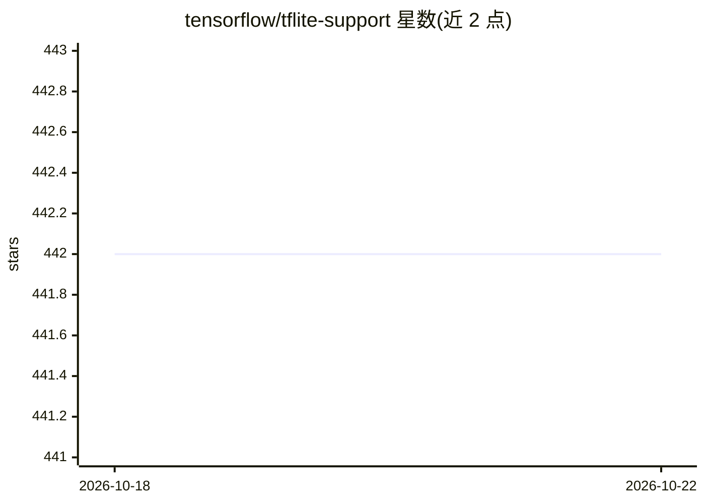

# tensorflow/tflite-support

⭐ 442 · C++ · Apache-2.0 · 推送 2026-10-21 · [GitHub](https://github.com/tensorflow/tflite-support) · 组织维护

**帮助开发者将 TFLite 模型部署到移动设备的工具库**

TensorFlow 官方的移动端 ML 部署工具包，含四部分：跨平台部署支持库（Java，C++/Swift 开发中）、模型元数据填充与提取库、基于元数据自动生成模型包装代码的 Codegen 工具、面向分类检测等常见任务的任务库。面向需要在 Android/iOS 等移动与 IoT 设备上运行 TFLite 推理的开发者，提供预处理/后处理工具库，行为与 TF.Image/TF.text 对齐。使用 Bazel 构建，Android 部分需配置 NDK/SDK 环境变量。

## 筛选速览

| 维度 | 判定 | 备注 |
|---|---|---|
| AI 角色 | `ai-ecosystem` | LLM/agent 周边工具 |
| 许可风险 | `permissive` | Apache-2.0 |
| 部署形态 | `None` |  |
| 模型依赖 | — | README 未给出锁定关系 |
| 硬件要求 | — | 无带数字的原话,不猜 |
| 安装摩擦 | `low` | 无编译、无系统依赖或容器化 |
| 成熟度 | `idea` | |

## 能力要点

- 跨平台 TFLite 部署支持库（Java，C++/Swift 开发中）
- 模型元数据（metadata populator/extractor）库
- 基于元数据自动生成模型包装代码的 Codegen 工具
- 面向常见 ML 任务的任务库与预处理/后处理工具

## 适用场景

- 在 Android/iOS 应用中集成 TFLite 模型推理
- 为模型生成带元数据的包装接口
- 构建自定义推理流水线并复用预处理/后处理工具

## 场景标签

 · 领域:移动/端侧机器学习部署

## 证据(README 行号)

> L3: TFLite Support is a toolkit that helps users to develop ML and deploy TFLite
> L15: * **TFLite Support Task Library**: a flexible and ready-to-use library for

## 星数曲线

2026-10-18 442 → 2026-10-22 442（+0）

---
*卡片 v1 · prompt 1.4 · 生成 2026-10-21 · 置信度 high · 依据 README sha `af7428918ce6` · [字段定义](../../DATASET.md)*
