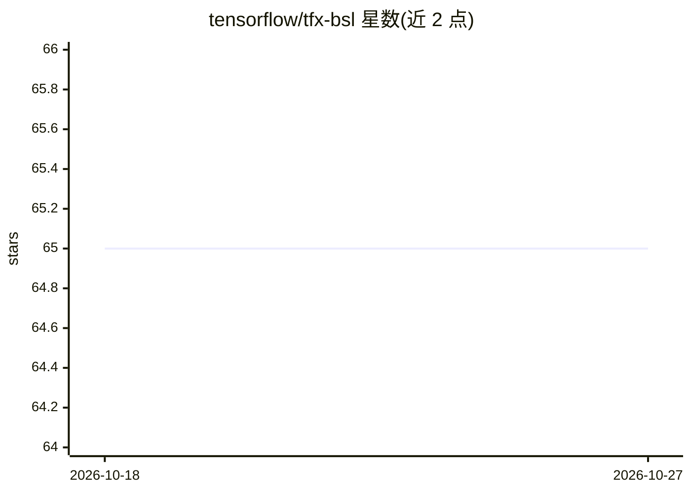

# tensorflow/tfx-bsl

⭐ 65 · Python · NOASSERTION · 推送 2026-08-14 · [GitHub](https://github.com/tensorflow/tfx-bsl) · 组织维护

**TFX 各组件共享的基础 Python 库**

TensorFlow eXtended（TFX）生态的共享基础库：为 TFX 组件及独立 TFX 库（TFDV、TFMA、TFT）提供公共代码。仅 `tfx_bsl/public` 子模块导出的符号面向 TFX 用户，API 在 1.0 之后才遵循语义化版本。各 TFX 库的次要版本与 tfx_bsl 特定次要版本绑定，普通用户通常无需直接安装。以 PyPI 包分发，也提供 nightly 包与 Bazel/cibuildwheel 源码构建方式，测试平台为 macOS 10.12.6+ 与 Ubuntu 20.04+，并给出与 apache-beam、pyarrow、tensorflow 等的版本兼容表。

## 筛选速览

| 维度 | 判定 | 备注 |
|---|---|---|
| AI 角色 | `ai-ecosystem` | LLM/agent 周边工具 |
| 许可风险 | `none` | NOASSERTION |
| 部署形态 | `library` | 以包/库形式分发 |
| 模型依赖 | — | README 未给出锁定关系 |
| 硬件要求 | — | 无带数字的原话,不猜 |
| 安装摩擦 | `low` | 无编译、无系统依赖或容器化 |
| 成熟度 | — | 结构信号不足 |

## 能力要点

- 为 TFX 组件与 TFDV/TFMA/TFT 提供共享代码
- 公开 API 限定于 `tfx_bsl/public` 子模块
- PyPI 发布 + Google Cloud 托管 nightly 包
- 提供与 apache-beam/pyarrow/tensorflow 等的版本兼容矩阵

## 适用场景

- 开发 TFX 自定义组件时使用其公开 API
- TFX 各组件作为依赖引入
- 查阅 TFX 生态各库的版本兼容关系

## 场景标签

`MLOps` · 领域:训练与推理

## 证据(README 行号)

> L6: TFX Basic Shared Libraries (`tfx_bsl`) contains libraries shared by many
> L10: direct use by TFX users__, including by standalone TFX library (e.g. TFDV, TFMA,

## 星数曲线

2026-10-18 65 → 2026-10-27 65（+0）

---
*卡片 v1 · prompt 1.4 · 生成 2026-10-24 · 置信度 high · 依据 README sha `35b7f4b9a6c4` · [字段定义](../../DATASET.md)*
