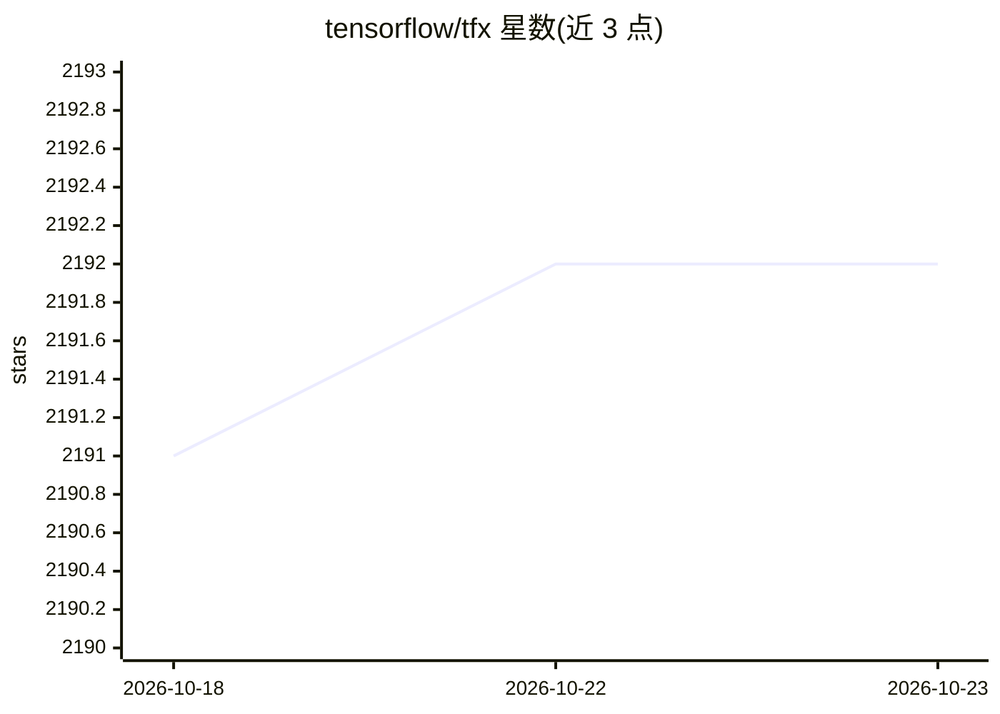

# tensorflow/tfx

⭐ 2,192 · Python · Apache-2.0 · 推送 2026-10-20 · [GitHub](https://github.com/tensorflow/tfx) · [官网](https://tensorflow.github.io/tfx/) · 组织维护

**给 ML 工程师：基于 TensorFlow 的生产级端到端 ML 流水线平台**

Google 出品的基于 TensorFlow 的生产级机器学习平台 TFX：提供配置框架来表达由 TFX 组件构成的 ML 流水线，可用 Apache Airflow 和 Kubeflow Pipelines 编排，组件与编排系统集成均可扩展。组件通过 ML Metadata 后端记录运行、输入输出 artifact 与运行时配置，支持实验追踪与从历史运行预热/恢复模型。以 PyPI Python 包分发，README 给出各版本与 Python、apache-beam、tensorflow 等依赖的兼容矩阵及教程资源。

## 筛选速览

| 维度 | 判定 | 备注 |
|---|---|---|
| AI 角色 | `ai-ecosystem` | LLM/agent 周边工具 |
| 许可风险 | `permissive` | Apache-2.0 |
| 部署形态 | `library` | 以包/库形式分发 |
| 模型依赖 | — | README 未给出锁定关系 |
| 硬件要求 | — | 无带数字的原话,不猜 |
| 安装摩擦 | `low` | 无编译、无系统依赖或容器化 |
| 成熟度 | — | 结构信号不足 |

## 能力要点

- 配置化框架表达由组件构成的 ML 流水线
- 支持 Apache Airflow 与 Kubeflow Pipelines 编排，且可扩展
- ML Metadata 后端记录组件运行与 artifact，支持实验追踪与 warm start
- 提供版本级依赖兼容矩阵与 Chicago Taxi 示例

## 适用场景

- 在生产环境搭建与部署 ML 训练流水线
- 用 Airflow/Kubeflow 编排 ML 组件并追踪实验元数据
- 从历史流水线运行恢复或预热模型

## 场景标签

`MLOps` · 领域:训练与推理

## 证据(README 行号)

> L7: TensorFlow Extended (TFX) is a
> L9: provides a configuration framework to express ML pipelines consisting of TFX

## 星数曲线

2026-10-18 2,191 → 2026-10-23 2,192（+1）

---
*卡片 v1 · prompt 1.4 · 生成 2026-10-21 · 置信度 high · 依据 README sha `e56748b1d395` · [字段定义](../../DATASET.md)*
