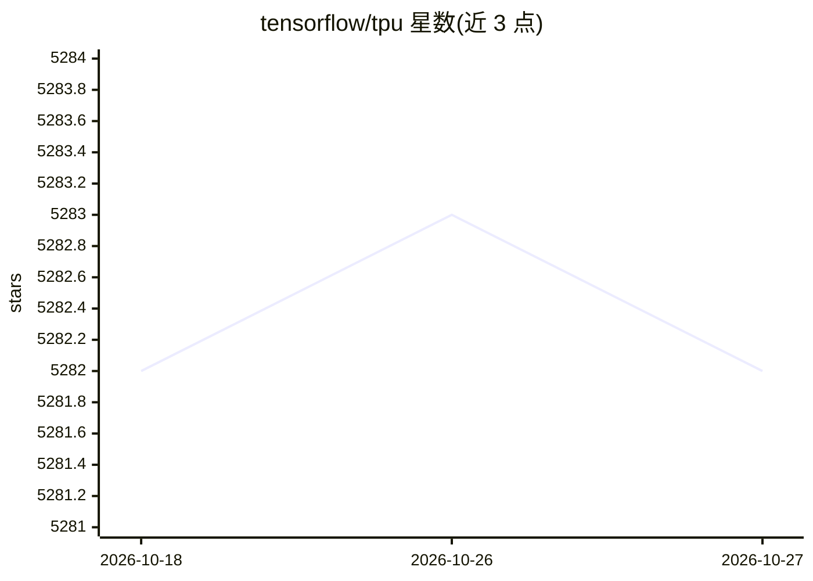

# tensorflow/tpu

⭐ 5,282 · Jupyter Notebook · Apache-2.0 · 推送 2026-06-22 · [GitHub](https://github.com/tensorflow/tpu) · [官网](https://cloud.google.com/tpu/) · 组织维护

**Cloud TPU 官方参考模型与工具集合**

Google 维护的 Cloud TPU 参考模型与工具仓库，包含 models 子目录下的参考模型，供在 Cloud TPU 上训练模型使用。入门路径为通过 Google Cloud Shell 启动教程。README 声明该仓库为公共镜像，不接受 pull request，功能或缺陷需求通过 issue 提交。运行 models 子目录中的模型时需将顶层 /models 目录加入 Python path。

## 筛选速览

| 维度 | 判定 | 备注 |
|---|---|---|
| AI 角色 | `ai-ecosystem` | LLM/agent 周边工具 |
| 许可风险 | `permissive` | Apache-2.0 |
| 部署形态 | `None` |  |
| 模型依赖 | — | README 未给出锁定关系 |
| 硬件要求 | — | 无带数字的原话,不猜 |
| 安装摩擦 | `low` | 无编译、无系统依赖或容器化 |
| 成熟度 | — | 结构信号不足 |

## 能力要点

- 提供 Cloud TPU 参考模型与工具集合
- 含通过 Google Cloud Shell 启动的入门教程
- 运行模型需将 /models 目录加入 PYTHONPATH

## 适用场景

- 在 Cloud TPU 上训练参考模型
- 查找官方提供的 TPU 参考实现
- 通过教程快速上手 Cloud TPU 训练

## 场景标签

`模型训练` `教程课程` · 领域:学习与行业

## 证据(README 行号)

> L3: This repository is a collection of reference models and tools used with
> L6: The fastest way to get started training a model on a Cloud TPU is by following

## 星数曲线

2026-10-18 5,282 → 2026-10-27 5,282（+0）

---
*卡片 v1 · prompt 1.4 · 生成 2026-10-20 · 置信度 high · 依据 README sha `0c6b9ec3eb53` · [字段定义](../../DATASET.md)*
