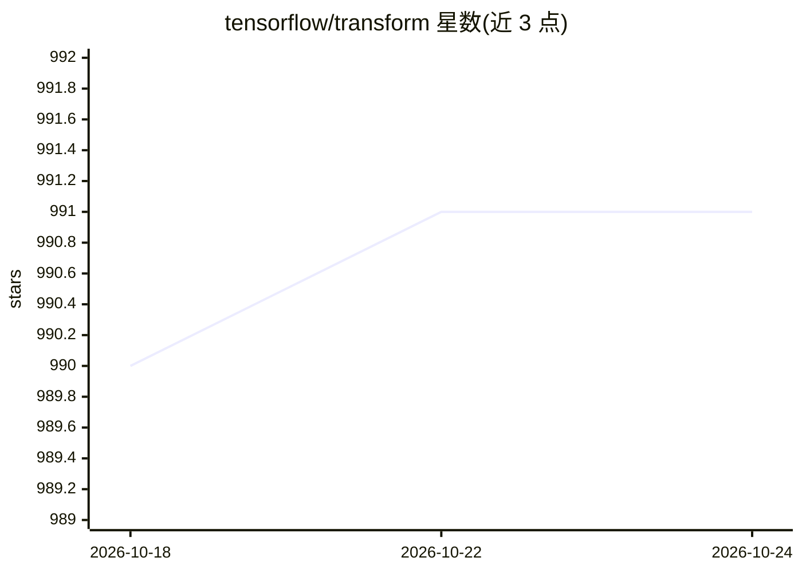

# tensorflow/transform

⭐ 991 · Python · Apache-2.0 · 推送 2026-08-14 · [GitHub](https://github.com/tensorflow/transform) · 组织维护

**给机器学习开发者的 TensorFlow 数据预处理流水线库**

TensorFlow Transform（tf.Transform）是用于 TensorFlow 数据预处理的 Python 库，面向需要全量遍历（full-pass）的数据变换，如按均值方差归一化、生成词表将字符串转整数、按分布分桶。变换结果导出为 TensorFlow graph，训练与 serving 复用同一图以避免 skew。依赖 TensorFlow、Apache Beam（默认本地模式，可经 Google Cloud Dataflow 等分布式运行）与 Apache Arrow；提供 PyPI 安装、源码构建与 nightly 包，并维护版本兼容表。

## 筛选速览

| 维度 | 判定 | 备注 |
|---|---|---|
| AI 角色 | `ai-ecosystem` | LLM/agent 周边工具 |
| 许可风险 | `permissive` | Apache-2.0 |
| 部署形态 | `library` | 以包/库形式分发 |
| 模型依赖 | — | README 未给出锁定关系 |
| 硬件要求 | — | 无带数字的原话,不猜 |
| 安装摩擦 | `low` | 无编译、无系统依赖或容器化 |
| 成熟度 | — | 结构信号不足 |

## 能力要点

- 支持全量遍历的数据变换（归一化、词表生成、分桶）
- 变换导出为 TensorFlow graph，训练与 serving 复用以避免 skew
- 基于 Apache Beam 支持本地与分布式（Dataflow 等）计算
- 维护各依赖包版本兼容表并发布 nightly 包

## 适用场景

- 为 TensorFlow 训练流水线构建一致的预处理图
- 需要对全量数据统计的归一化、词表与分桶处理
- 训练与线上 serving 保持相同变换以避免偏差

## 场景标签

`MLOps` · 领域:训练与推理

## 证据(README 行号)

> L7: *TensorFlow Transform* is a library for preprocessing data with TensorFlow.
> L19: The output of `tf.Transform` is exported as a
> L21: serving. Using the same graph for both training and serving can prevent skew

## 星数曲线

2026-10-18 990 → 2026-10-24 991（+1）

---
*卡片 v1 · prompt 1.4 · 生成 2026-10-21 · 置信度 high · 依据 README sha `e64ab1f6c388` · [字段定义](../../DATASET.md)*
