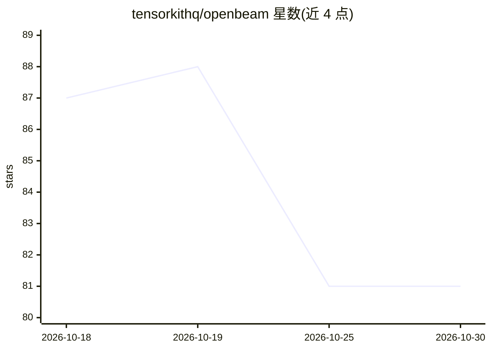

# tensorkithq/openbeam

⭐ 81 · TypeScript · 推送 2026-08-29 · [GitHub](https://github.com/tensorkithq/openbeam) · [官网](https://openbeam.tensorkit.ai) · 组织维护

**面向直播讲道的实时经文检测浏览器应用**

OpenBeam 是桌面应用 Rhema 的云端版本：通过浏览器麦克风采集讲道音频，经 Deepgram Nova-3 实时转录后，用四种并行策略检测讲道中提及或暗指的圣经经文——Aho-Corasick 自动机匹配书名与口语化章节引用、Qwen3-Embedding-8B 语义检索（经 OpenRouter，索引 31,000+ 经文向量）、逐字引用倒排索引，最后经置信度加权合并去重。检测结果可作 OBS/vMix/xSplit 直播叠加层，支持 10+ 译本、OSC/HTTP 遥控。用户自带 Deepgram key；云端版无离线模式。提供托管站点与 Rust/React 自部署路径。

## 筛选速览

| 维度 | 判定 | 备注 |
|---|---|---|
| AI 角色 | `ai-native` | 本体是模型或模型工具 |
| 许可风险 | `none` | — |
| 部署形态 | `None` |  |
| 模型依赖 | locked-api |  |
| 硬件要求 | — | 无带数字的原话,不猜 |
| 安装摩擦 | `low` | 无编译、无系统依赖或容器化 |
| 成熟度 | — | 结构信号不足 |

## 能力要点

- 四策略并行检测管线（Aho-Corasick/语义检索/引用匹配/集成合并）
- 检测经文实时输出为 OBS/vMix/xSplit 直播叠加层
- 10+ 圣经译本与 340,000+ 交叉引用，SQLite FTS5 全文检索
- 用户自带 Deepgram key（BYOK），服务端无用户数据存储

## 适用场景

- 礼拜直播时自动把讲道提到的经文显示到画面叠加层
- 讲道者口头暗指经文（未报书名章节）时自动定位出处
- 用 Stream Deck/TouchOSC 远程控制经文队列与叠加显示

## 场景标签

 · 领域:直播/宗教媒体工具

## 证据(README 行号)

> L7: OpenBeam is the cloud companion to Rhema, a desktop application for real-time Bible verse detection during live serm
> L21: OpenBeam doesn't use a single method to find verses. It runs four strategies simultaneously and merges results with
> L29: Embeds transcript segments via Qwen3-Embedding-8B through OpenRouter, then searches a pre-built HNSW vector index o
> L54: |**Speech-to-Text**|Deepgram Nova-3 (BYOK — bring your own key)|

## 星数曲线

2026-10-18 87 → 2026-10-30 81（-6）

---
*卡片 v1 · prompt 1.4 · 生成 2026-10-23 · 置信度 high · 依据 README sha `c3f4f28d7bac` · [字段定义](../../DATASET.md)*
