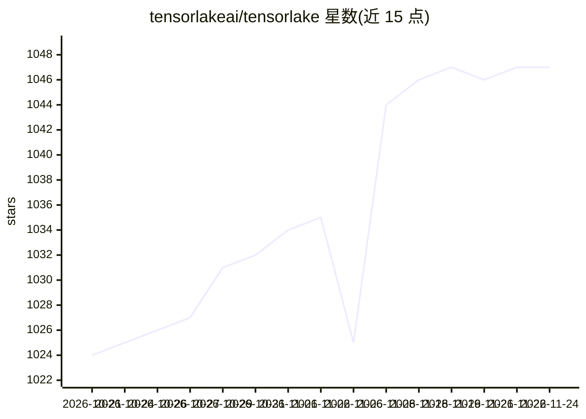

# tensorlakeai/tensorlake

⭐ 1,047 · Rust · Apache-2.0 · 推送 2026-11-13 · [GitHub](https://github.com/tensorlakeai/tensorlake) · [官网](https://tensorlake.ai) · 组织维护

**面向 AI agent 的沙箱云与 serverless 编排运行时**

Tensorlake 提供基于 MicroVM 的沙箱执行环境与 serverless 函数编排运行时，用于构建 agent 应用：沙箱可作为 agent 运行环境或执行工具与 LLM 生成代码的隔离环境。关键机制包括块存储文件系统、快照与克隆、空闲自动挂起/恢复、跨机在线迁移，单项目宣称支持至 500 万沙箱。使用需注册 cloud.tensorlake.ai 获取 API key，提供 Python SDK、TypeScript SDK 与独立二进制 CLI（tl），沙箱镜像默认构建 CAS 格式，GPU 沙箱必须使用 CAS 镜像，不支持任意 Docker 镜像引用。

## 筛选速览

| 维度 | 判定 | 备注 |
|---|---|---|
| AI 角色 | `ai-ecosystem` | LLM/agent 周边工具 |
| 许可风险 | `permissive` | Apache-2.0 |
| 部署形态 | `self-host` | docker 或自建部署 |
| 模型依赖 | — | README 未给出锁定关系 |
| 硬件要求 | — | 无带数字的原话,不猜 |
| 安装摩擦 | `low` | 无编译、无系统依赖或容器化 |
| 成熟度 | — | 结构信号不足 |

## 能力要点

- MicroVM 沙箱：快照/克隆、空闲挂起恢复、秒级在线迁移
- serverless 函数运行时支持 agent 长时编排与 fan-out
- Python/TypeScript SDK 与 tl CLI，输出字节预算与超时控制
- CAS 镜像按需加载内容，GPU 沙箱强制使用

## 适用场景

- 为 agent 运行 LLM 生成的代码提供隔离沙箱
- 部署需要长时间运行的后台 agentic 应用
- 需要大量可快照、可克隆的执行环境

## 场景标签

`Agent 框架` `工作流自动化` · 领域:Agent 开发

## 证据(README 行号)

> L11: Tensorlake is a compute infrastructure platform for building agentic applications with sandboxes.
> L13: The Sandbox API creates MicroVM sandboxes which you can use to run agents, or use them as an isolated environment f
> L15: In addition to stateful VMs, you can also add long running orchestration capabilities to Agents using a serverless 

## 星数曲线

2026-10-21 1,024 → 2026-11-24 1,047（+23）

---
*卡片 v1 · prompt 1.4 · 生成 2026-11-24 · 置信度 mid · 依据 README sha `c83d5cf9c829` · [字段定义](../../DATASET.md)*
