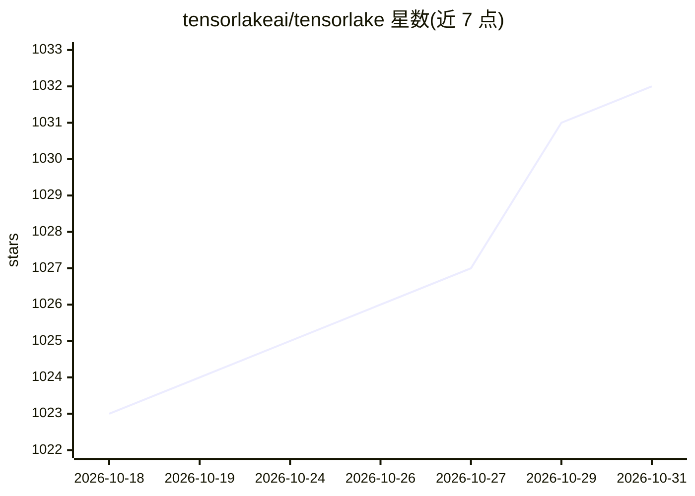

# tensorlakeai/tensorlake

⭐ 1,032 · Rust · Apache-2.0 · 推送 2026-10-29 · [GitHub](https://github.com/tensorlakeai/tensorlake) · [官网](https://tensorlake.ai) · 组织维护

**面向 AI agent 的沙箱云与 serverless 编排运行时**

Tensorlake 是构建 agentic 应用的计算基础设施平台：通过 Sandbox API 创建有状态 MicroVM 沙箱，用于运行 agent、工具或 LLM 生成的代码；附带支持 fan-out 的 serverless 函数运行时做长时编排。能力包括亚秒级启动、快照与克隆、自动挂起恢复、活动迁移，单项目最多 500 万沙箱；另有版本化 Cloud Volumes 文件系统。提供 Python/TypeScript/Rust SDK 与独立二进制 CLI（tl），需注册云服务获取 API key；不支持任意 Docker 镜像引用，仅限已注册的 Sandbox Image。

## 筛选速览

| 维度 | 判定 | 备注 |
|---|---|---|
| AI 角色 | `ai-ecosystem` | LLM/agent 周边工具 |
| 许可风险 | `permissive` | Apache-2.0 |
| 部署形态 | `self-host` | docker 或自建部署 |
| 模型依赖 | — | README 未给出锁定关系 |
| 硬件要求 | — | 无带数字的原话,不猜 |
| 安装摩擦 | `low` | 无编译、无系统依赖或容器化 |
| 成熟度 | — | 结构信号不足 |

## 能力要点

- MicroVM 沙箱亚秒级启动，Lattice 动态调度，单项目支持至 500 万沙箱
- 快照/克隆、自动挂起恢复与不停机活动迁移
- 沙箱池预热容器与 GPU 分配（A10/H100 等型号）
- 版本化 Cloud Volumes 文件系统，数据不经 API 服务直传对象存储

## 适用场景

- 为 agent 或 LLM 生成的代码提供隔离执行环境
- 构建需要 fan-out 的后台 agentic 应用
- 预热沙箱池并按需分配 GPU 资源

## 场景标签

`Agent 框架` `工作流自动化` · 领域:Agent 开发

## 证据(README 行号)

> L11: Tensorlake is a compute infrastructure platform for building agentic applications with sandboxes.
> L13: The Sandbox API creates MicroVM sandboxes which you can use to run agents, or use them as an isolated environment f
> L15: In addition to stateful VMs, you can also add long running orchestration capabilities to Agents using a serverless 

## 星数曲线

2026-10-18 1,023 → 2026-10-31 1,032（+9）

---
*卡片 v1 · prompt 1.4 · 生成 2026-10-21 · 置信度 mid · 依据 README sha `d5be0a670bcd` · [字段定义](../../DATASET.md)*
