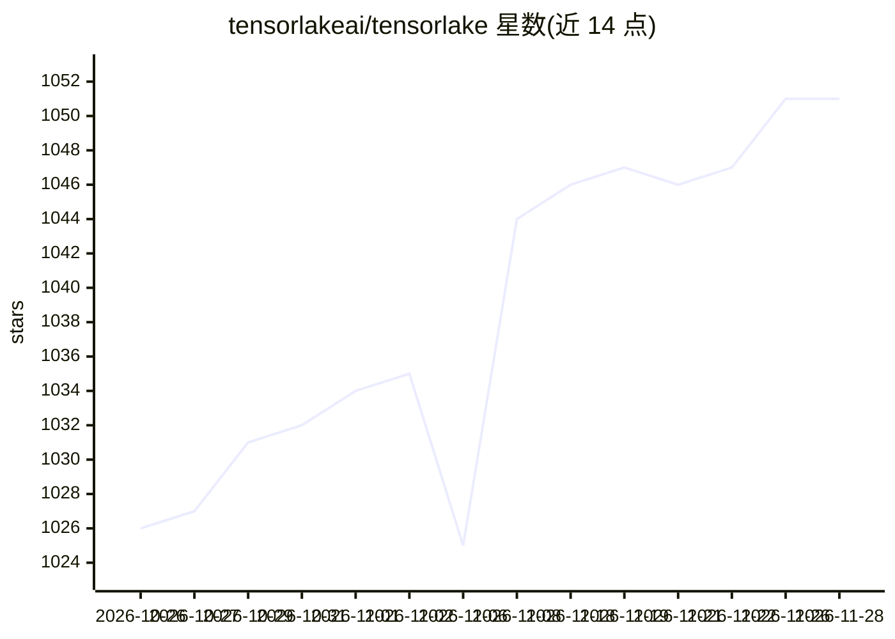

# tensorlakeai/tensorlake

⭐ 1,051 · Rust · Apache-2.0 · 推送 2026-11-27 · [GitHub](https://github.com/tensorlakeai/tensorlake) · [官网](https://tensorlake.ai) · 组织维护

**为 AI Agent 开发者提供沙盒化无服务器运行环境**

Tensorlake 是一个计算基础设施平台，提供基于 MicroVM 的沙盒 API，用于运行 Agent、工具或 LLM 生成的代码。关键机制包括亚秒级沙盒启动（Lattice 调度器）、快照与克隆、空闲自动挂起/恢复、跨机实时迁移、CAS 按需加载镜像及异步构建操作，支持单项目最多 500 万沙盒。提供 Python SDK、TypeScript/Rust SDK 与 tl CLI；使用需注册 cloud.tensorlake.ai 获取 API key；自定义环境仅支持注册的沙盒镜像，不支持任意 Docker 镜像引用。

## 筛选速览

| 维度 | 判定 | 备注 |
|---|---|---|
| AI 角色 | `ai-ecosystem` | LLM/agent 周边工具 |
| 许可风险 | `permissive` | Apache-2.0 |
| 部署形态 | `self-host` | docker 或自建部署 |
| 模型依赖 | — | README 未给出锁定关系 |
| 硬件要求 | — | 无带数字的原话,不猜 |
| 安装摩擦 | `low` | 无编译、无系统依赖或容器化 |
| 成熟度 | — | 结构信号不足 |

## 能力要点

- MicroVM 沙盒：亚秒级启动、快照/克隆、空闲挂起/恢复、实时迁移
- 多语言 SDK（Python/TypeScript/Rust）与 tl CLI
- CAS 镜像按需冷启动与异步构建操作（get/wait/cancel）
- 运行中沙盒支持 CPU/内存/根磁盘在线扩缩

## 适用场景

- 为 Agent 工具执行或 LLM 生成代码提供隔离运行环境
- 需要大量并发、可暂停恢复的有状态执行环境
- 构建并导入私有基础镜像用于沙盒环境定制

## 场景标签

 · 领域:AI 基础设施/沙盒运行时

## 证据(README 行号)

> L11: Tensorlake is a compute infrastructure platform for building agents with sandboxes.
> L13: The Sandbox API creates MicroVM sandboxes which you can use to run agents, or use them as an isolated environment f
> L17: Tensorlake Sandboxes provide instant, stateful execution environments for AI agents — spin up millions of sandboxes

## 星数曲线

2026-10-26 1,026 → 2026-11-28 1,051（+25）

---
*卡片 v1 · prompt 1.4 · 生成 2026-11-28 · 置信度 mid · 依据 README sha `b4f6bf5927f7` · [字段定义](../../DATASET.md)*
