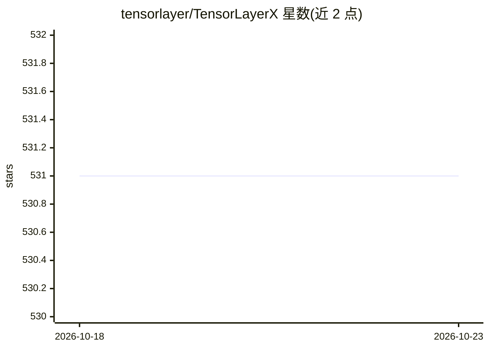

# tensorlayer/TensorLayerX

⭐ 531 · Python · NOASSERTION · 推送 2026-01-23 · [GitHub](https://github.com/tensorlayer/TensorLayerX) · 组织维护 · 中文 README

**多后端深度学习/强化学习框架，一套代码跨框架跨硬件运行**

支持 TensorFlow、PyTorch、MindSpore、PaddlePaddle、OneFlow、Jittor 作为后端的统一深度学习框架，通过环境变量切换后端，使同一代码运行于 Nvidia-GPU、华为昇腾、寒武纪等硬件。提供 Model Zoo（覆盖 CV/NLP/RL 的经典与 SOTA 模型）、ONNX 模型导出部署、Paddle2TLX 代码转换器。由北京大学、鹏城实验室、HKUST、帝国理工、普林斯顿、牛津、斯坦福、清华、爱丁堡等机构研究者维护。以 Python 库形式通过 pip 安装，另提供 Docker 镜像。

## 筛选速览

| 维度 | 判定 | 备注 |
|---|---|---|
| AI 角色 | `ai-ecosystem` | LLM/agent 周边工具 |
| 许可风险 | `none` | NOASSERTION |
| 部署形态 | `self-host` | docker 或自建部署 |
| 模型依赖 | — | README 未给出锁定关系 |
| 硬件要求 | — | 无带数字的原话,不猜 |
| 安装摩擦 | `low` | 无编译、无系统依赖或容器化 |
| 成熟度 | — | 结构信号不足 |

## 能力要点

- 6 种后端（TensorFlow/PyTorch/MindSpore/PaddlePaddle/OneFlow/Jittor）通过环境变量切换
- 支持 Nvidia-GPU、华为昇腾、寒武纪等多硬件
- Model Zoo 覆盖 CV/NLP/RL，支持 ONNX 导出部署
- 可与 TensorFlow/PyTorch/Paddle/MindSpore 混合编程

## 适用场景

- 编写一次模型代码在多个深度学习框架后端上运行
- 需要跨国产框架（MindSpore/PaddlePaddle/OneFlow/Jittor）迁移或部署的模型开发
- 将 PaddlePaddle 模型代码转换为多后端可运行代码

## 场景标签

`模型训练` · 领域:训练与推理

## 证据(README 行号)

> L12: TensorLayerX is a multi-backend AI framework, supports TensorFlow, Pytorch, MindSpore, PaddlePaddle, OneFlow and Ji
> L27: - ***Compatibility***: Support worldwide frameworks and AI chips, enabling one code runs on all platforms.

## 星数曲线

2026-10-18 531 → 2026-10-23 531（+0）

---
*卡片 v1 · prompt 1.4 · 生成 2026-10-21 · 置信度 high · 依据 README sha `4b7fcfdf199f` · [字段定义](../../DATASET.md)*
