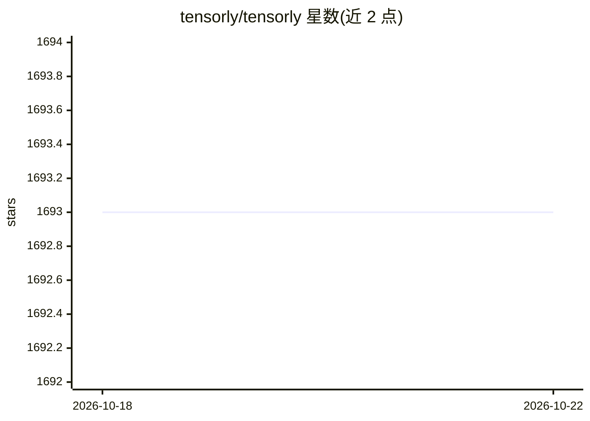

# tensorly/tensorly

⭐ 1,693 · Python · NOASSERTION · 推送 2026-10-21 · [GitHub](https://github.com/tensorly/tensorly) · [官网](http://tensorly.org) · 组织维护

**Python 张量学习库：张量分解、张量代数与多后端计算**

面向研究者与开发者的 Python 张量运算库，提供张量分解（Tucker、CP、TT 等）、张量代数与回归等方法。核心机制是后端系统：可在 NumPy、PyTorch、JAX、TensorFlow、CuPy、Paddle 之间切换，同一套 API 在 CPU 或 GPU 上运行。默认仅依赖 NumPy，其他后端需另行安装对应框架。以 pip/conda 包与源码两种方式分发，并附 Jupyter Notebook 示例仓库。

## 筛选速览

| 维度 | 判定 | 备注 |
|---|---|---|
| AI 角色 | `ai-native` | 本体是模型或模型工具 |
| 许可风险 | `none` | NOASSERTION |
| 部署形态 | `library` | 以包/库形式分发 |
| 模型依赖 | — | README 未给出锁定关系 |
| 硬件要求 | — | 无带数字的原话,不猜 |
| 安装摩擦 | `medium` | 含编译或系统依赖之一 |
| 成熟度 | — | 结构信号不足 |

## 能力要点

- 张量分解（Tucker/CP/TT 等多种格式）与重构
- 后端系统支持 NumPy/PyTorch/JAX/TensorFlow/CuPy/Paddle 切换
- 同一 API 可在 CPU 或 GPU（如 cuda:0 设备）上计算
- 提供随机张量生成与因子化形式创建

## 适用场景

- 对高维数据做 Tucker/CP 分解与降维
- 在 PyTorch/JAX 等框架中复用张量方法并跑在 GPU 上
- 科研论文中做张量学习实验并按 JMLR 论文引用

## 场景标签

 · 领域:机器学习/科学计算

## 证据(README 行号)

> L18: TensorLy is a Python library that aims at making tensor learning simple and accessible. It allows to easily perform
> L85: You can change the backend to perform computation with a different framework. By default, the backend is NumPy, but

## 星数曲线

2026-10-18 1,693 → 2026-10-22 1,693（+0）

---
*卡片 v1 · prompt 1.4 · 生成 2026-10-21 · 置信度 high · 依据 README sha `bea5c541e944` · [字段定义](../../DATASET.md)*
