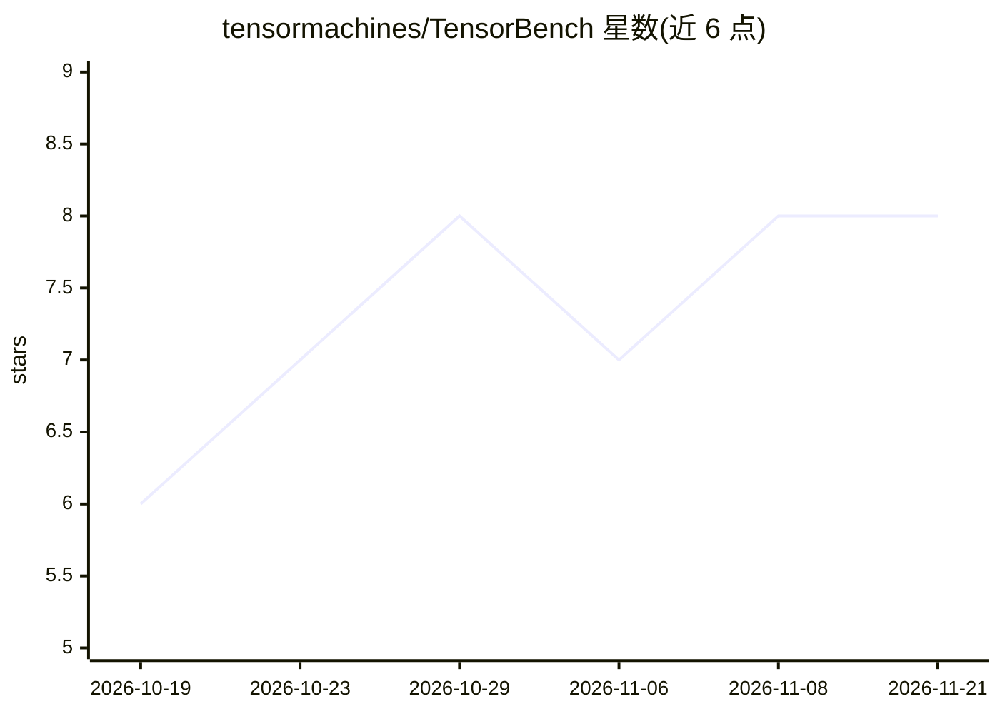

# tensormachines/TensorBench

⭐ 8 · Python · Apache-2.0 · 推送 2026-10-08 · [GitHub](https://github.com/tensormachines/TensorBench) · [官网](https://www.tensormachines.org/) · 组织维护

**为数据中心与 MLOps 团队评测加速器真实性能与单位经济性的基准**

以单命令 ./run.sh 驱动的基础设施基准：从裸机驱动安装、Docker 构建到打分全流程自动执行，对 GPU 依次运行矩阵乘、内存带宽、多精度 Llama 推理、微调、卷积、FFT、NCCL 集合通信等工作负载，同时采集 NVML/BMC 功耗遥测。核心输出为百万 token 成本分，由吞吐、功耗与电价、持有成本、利用率等输入按公开公式计算，并记录失败阶段继续运行。限 Ubuntu 22.04、指定 NVIDIA GPU/平台，需格式化一块 ≥500GB 备用盘与 Hugging Face token。

## 筛选速览

| 维度 | 判定 | 备注 |
|---|---|---|
| AI 角色 | `ai-ecosystem` | LLM/agent 周边工具 |
| 许可风险 | `permissive` | Apache-2.0 |
| 部署形态 | `None` |  |
| 模型依赖 | — | README 未给出锁定关系 |
| 硬件要求 | — | 无带数字的原话,不猜 |
| 安装摩擦 | `medium` | 含编译或系统依赖之一 |
| 成熟度 | — | 结构信号不足 |

## 能力要点

- 单命令完成驱动安装到打分的全流程，支持断点续跑与 --dry-run
- 同时采集 GPU 计算吞吐、功耗边界与每百万 token 成本
- 公开打分公式与 score.json 输出全部中间量供自算
- 通过 GPU/platform profile JSON 扩展新硬件，欢迎提交 PR

## 适用场景

- 评估现有 GPU 集群在真实 LLM 推理负载下的单位 token 成本
- 为采购或租用决策获取基于工作负载的硬件经济性数据
- 在不同功耗与利用率假设下重算节点成本

## 场景标签

`模型评测` · 领域:评测与运维

## 证据(README 行号)

> L3: TensorBench is an open-source infrastructure benchmark designed to measure the
> L12: demand impact actual token yield, TensorBench gives data center operators, MLOps
> L104: |1C LLM inference, Llama 3 8B INT8 (used for the score)|8|7|

## 星数曲线

2026-10-19 6 → 2026-11-21 8（+2）

---
*卡片 v1 · prompt 1.4 · 生成 2026-11-20 · 置信度 high · 依据 README sha `752c844d55d2` · [字段定义](../../DATASET.md)*
