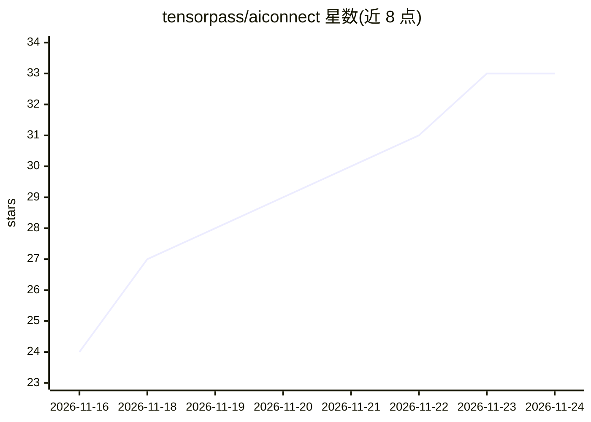

# tensorpass/aiconnect

⭐ 42 · TypeScript · Apache-2.0 · 推送 2026-11-24 · [GitHub](https://github.com/tensorpass/aiconnect) · [官网](https://tensorpass.app/docs) · 组织维护

**网站 AI 功能 SDK：让访客用自己的 AI 账号付费回答**

TensorPass 开源的网站 AI 接入 SDK：在页面中添加 AI 聊天、可回答的搜索栏或 AI 模式，推理请求经 AI Wallet 浏览器扩展以访客自己的 ChatGPT/Claude/Gemini/Grok/OpenRouter 账号或 API key 签名发送给提供方，站点无需持有 provider key、不承担 token 成本。站点数据与工具以 MCP server 暴露，由访客的模型调用；无扩展的访客可通过 OpenRouter 或 TensorPass 计划网页登录。提供 React 组件、Web Components（约 650KB，8KB loader）、WordPress 与 Claude Code 插件四类包。

## 筛选速览

| 维度 | 判定 | 备注 |
|---|---|---|
| AI 角色 | `ai-ecosystem` | LLM/agent 周边工具 |
| 许可风险 | `permissive` | Apache-2.0 |
| 部署形态 | `library` | 以包/库形式分发 |
| 模型依赖 | — | README 未给出锁定关系 |
| 硬件要求 | — | 无带数字的原话,不猜 |
| 安装摩擦 | `low` | 无编译、无系统依赖或容器化 |
| 成熟度 | — | 结构信号不足 |

## 能力要点

- BYOK 模式：请求经 AI Wallet 扩展用访客自有账号签名调用提供方
- 站点工具以 MCP server 暴露，模型经工具循环调用
- 支持 React/Web Components/WordPress/Claude Code 多形态接入
- AiConnect.fetch 可让现有 AI SDK 代码经钱包回答，无需改业务逻辑

## 适用场景

- 给自己的网站加 AI 聊天或回答式搜索而不承担推理成本
- 电商目录、预订查询、文档检索等站点数据通过 MCP 供访客模型读取
- 已用 OpenAI/Anthropic 等 SDK 的站点保持代码仅换 fetch 通道

## 场景标签

`聊天机器人` · 领域:对话与助手

## 证据(README 行号)

> L3: AI Connect is the open source SDK of TensorPass that lets the AI features of a website run on the AI account each vi
> L29: 4. The SDK reads your tool definitions from your MCP server and sends the conversation to the wallet through `chat`
> L41: |`@tensorpass/aiconnect`|`AiConnect`, the connection to the visitor's AI through the wallet. `AiConnect.fetch` and 

## 星数曲线

2026-11-16 24 → 2026-11-24 33（+9）

---
*卡片 v1 · prompt 1.4 · 生成 2026-11-18 · 置信度 high · 依据 README sha `9573a386f0b4` · [字段定义](../../DATASET.md)*
