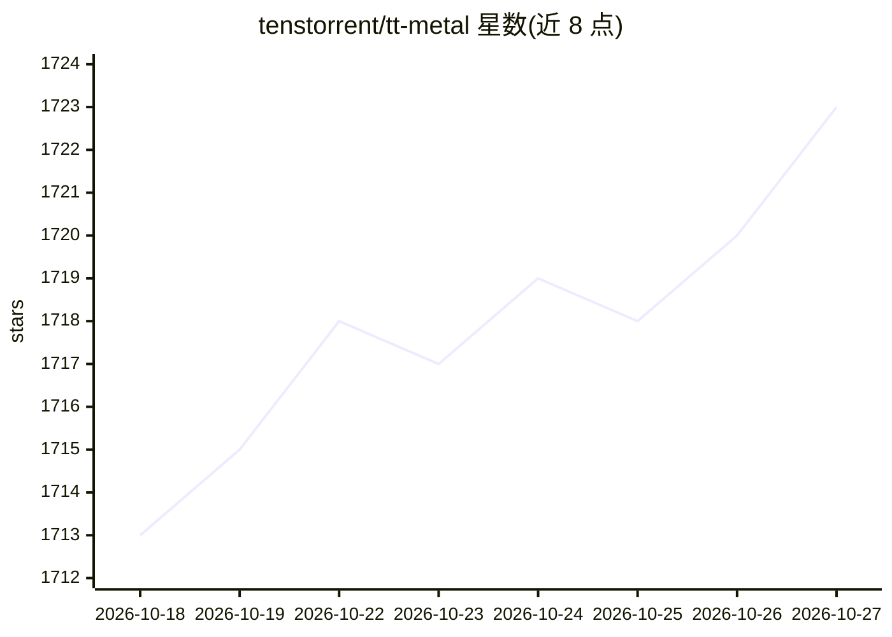

# tenstorrent/tt-metal

⭐ 1,723 · Python · Apache-2.0 · 推送 2026-10-26 · [GitHub](https://github.com/tenstorrent/tt-metal) · [官网](https://docs.tenstorrent.com/tt-metal/latest/ttnn/) · 组织维护

**Tenstorrent AI 加速卡的神级算子库与内核编程模型**

TT-NN 是面向 Tenstorrent 硬件的 Python/C++ 神经网络算子库，TT-Metalium 是其底层内核编程模型；两者共同构成在 Wormhole/Blackhole 等 Tenstorrent 设备上开发与运行模型的技术栈。仓库给出 Llama、Qwen、Whisper、Mixtral 等模型在具体硬件上的 TTFT/吞吐性能数据，配套可视化、调试与性能分析工具（TT-NN Visualizer、TT-Exalens、TT-SMI、Tracy 等），并维护发布版本与赏金计划。Apache 2.0 许可。

## 筛选速览

| 维度 | 判定 | 备注 |
|---|---|---|
| AI 角色 | `ai-ecosystem` | LLM/agent 周边工具 |
| 许可风险 | `permissive` | Apache-2.0 |
| 部署形态 | `None` |  |
| 模型依赖 | local-ok | 支持本地模型 |
| 硬件要求 | — | 无带数字的原话,不猜 |
| 安装摩擦 | `low` | 无编译、无系统依赖或容器化 |
| 成熟度 | — | 结构信号不足 |

## 能力要点

- TT-NN：面向 Tenstorrent 硬件的 Python/C++ 神经网络算子库
- TT-Metalium：低级内核编程模型，附大量内核示例
- 提供 Llama/Qwen/Whisper/Mixtral 在 Wormhole/Blackhole 上的性能数据
- 配套 Visualizer、TT-Exalens、TT-SMI、Tracy 等调试与性能工具

## 适用场景

- 在 Tenstorrent 加速卡上部署和优化 LLM 等模型
- 为 Tenstorrent 硬件开发底层内核
- 分析模型执行性能与调试设备运行状态

## 场景标签

`推理引擎` · 领域:训练与推理

## 证据(README 行号)

> L8: **TT-NN** is a Python & C++ Neural Network OP library.
> L83: **TT-Metalium** is our low-level programming model, enabling kernel development for Tenstorrent hardware.

## 星数曲线

2026-10-18 1,713 → 2026-10-27 1,723（+10）

---
*卡片 v1 · prompt 1.4 · 生成 2026-10-21 · 置信度 high · 依据 README sha `c17157d275e2` · [字段定义](../../DATASET.md)*
