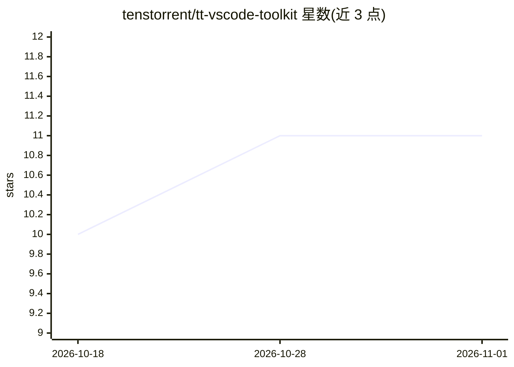

# tenstorrent/tt-vscode-toolkit

⭐ 11 · Python · Apache-2.0 · 推送 2026-10-30 · [GitHub](https://github.com/tenstorrent/tt-vscode-toolkit) · [官网](http://docs.tenstorrent.com/tt-vscode-toolkit/) · 组织维护

**面向 Tenstorrent AI 加速器的交互式教学与开发 VS Code 扩展**

由 Tenstorrent 维护的 VS Code 教育扩展：提供 53 节交互式课程（从硬件检测到自定义训练、从零构建 LLM），课程命令可点击执行，自动检测 Tenstorrent 设备（n150/n300/T3000/p100/p150/Galaxy）并给出针对性指引，状态栏实时显示温度/功耗/健康状态。课程覆盖 vLLM 生产推理、TT-Forge/TT-XLA 编译器、TT-Metalium 底层编程与 Cookbook 实践项目。前置要求为 Tenstorrent 加速器、Linux、Python 3.10+ 与已安装的 TT-Metalium；可通过 VS Code Marketplace、VSIX、源码或 Docker 方式使用，大量课程仍标注为 draft 未验证。

## 筛选速览

| 维度 | 判定 | 备注 |
|---|---|---|
| AI 角色 | `ai-ecosystem` | LLM/agent 周边工具 |
| 许可风险 | `permissive` | Apache-2.0 |
| 部署形态 | `self-host` | docker 或自建部署 |
| 模型依赖 | — | README 未给出锁定关系 |
| 硬件要求 | — | 无带数字的原话,不猜 |
| 安装摩擦 | `low` | 无编译、无系统依赖或容器化 |
| 成熟度 | — | 结构信号不足 |

## 能力要点

- 53 节交互式课程，按初/中/高级学习路径组织
- 自动检测 Tenstorrent 设备并实时监控温度/功耗/健康状态
- 课程内命令点击即运行，附带测试过的生产级代码模板
- 覆盖 vLLM、TT-Forge、TT-XLA、TT-Metalium 多框架教学

## 适用场景

- 开发者入门 Tenstorrent 硬件与软件栈
- 团队在 TT 加速器上搭建推理与自定义训练流程
- 通过 Cookbook 项目（元胞自动机、图像滤波等）练习硬件编程

## 场景标签

`教程课程` · 领域:学习与行业

## 证据(README 行号)

> L3: **Interactive learning and development tools for Tenstorrent AI accelerators**
> L17: - ✅ **53 Interactive Lessons** - From hardware detection to custom training, organized by skill level
> L22: - ✅ **Multi-Framework Support** - Learn vLLM, TT-Forge ™ , TT-XLA, and TT-Metalium ™

## 星数曲线

2026-10-18 10 → 2026-11-01 11（+1）

---
*卡片 v1 · prompt 1.4 · 生成 2026-11-01 · 置信度 high · 依据 README sha `b1549451e4b6` · [字段定义](../../DATASET.md)*
