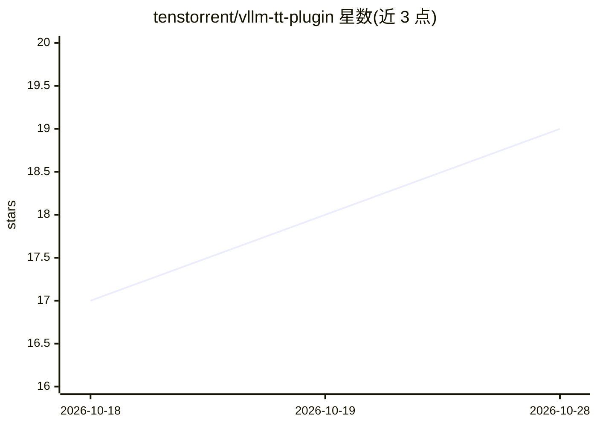

# tenstorrent/vllm-tt-plugin

⭐ 19 · Python · Apache-2.0 · 推送 2026-10-28 · [GitHub](https://github.com/tenstorrent/vllm-tt-plugin) · 组织维护

**将 Tenstorrent 硬件接入 vLLM 的后端插件，面向 TT 设备做 LLM 推理**

vLLM TT Plugin 通过 vLLM 标准插件机制把 Tenstorrent 硬件注册为 vLLM 平台，在 ttnn 可导入时自动检测并启用。插件自包含模型注册、平台检测、调度、worker 执行、模型加载、异步 decode 与数据并行执行，不改动 vLLM 核心。安装需先构建 tt-metal 环境，经脚本从源码构建 vLLM 0.30.0（VLLM_TARGET_DEVICE=empty），再以 uv 安装插件；支持 N150/N300/T3K/TG 等设备拓扑，运行 Llama、Qwen、GPT-OSS 等模型的离线生成与 OpenAI 兼容服务。旧版 vLLM 需切换 compat 标签，标签之上不做维护。

## 筛选速览

| 维度 | 判定 | 备注 |
|---|---|---|
| AI 角色 | `ai-ecosystem` | LLM/agent 周边工具 |
| 许可风险 | `permissive` | Apache-2.0 |
| 部署形态 | `library` | 以包/库形式分发 |
| 模型依赖 | local-ok | 支持本地模型 |
| 硬件要求 | — | 无带数字的原话,不猜 |
| 安装摩擦 | `medium` | 含编译或系统依赖之一 |
| 成熟度 | — | 结构信号不足 |

## 能力要点

- 标准 vLLM 插件机制接入 Tenstorrent 硬件，ttnn 可导入时自动检测 TT 平台
- 插件自包含模型注册、调度、worker 执行、异步 decode、数据并行执行，不改 vLLM 核心
- 支持 N150/N300/T3K/TG/BH-Galaxy 及自定义 mesh 的离线推理与 OpenAI 兼容服务示例
- 提供 on-device 采样、TT tracing、fabric 配置等选项键

## 适用场景

- 在 Tenstorrent 硬件上用 vLLM 运行 Llama/Qwen/GPT-OSS 等模型的推理服务
- 为 vLLM 部署增加 TT 后端平台而无需改核心代码
- 在 T3K/Galaxy 多卡拓扑上做离线批量推理与性能测量

## 场景标签

`推理引擎` · 领域:训练与推理

## 证据(README 行号)

> L3: Tenstorrent backend plugin for vLLM.
> L5: `vllm-tt-plugin` integrates Tenstorrent hardware into vLLM using the standard
> L10: The plugin is self-contained: model registration, platform detection, request

## 星数曲线

2026-10-18 17 → 2026-10-28 19（+2）

---
*卡片 v1 · prompt 1.4 · 生成 2026-10-28 · 置信度 mid · 依据 README sha `f5412727ef49` · [字段定义](../../DATASET.md)*
