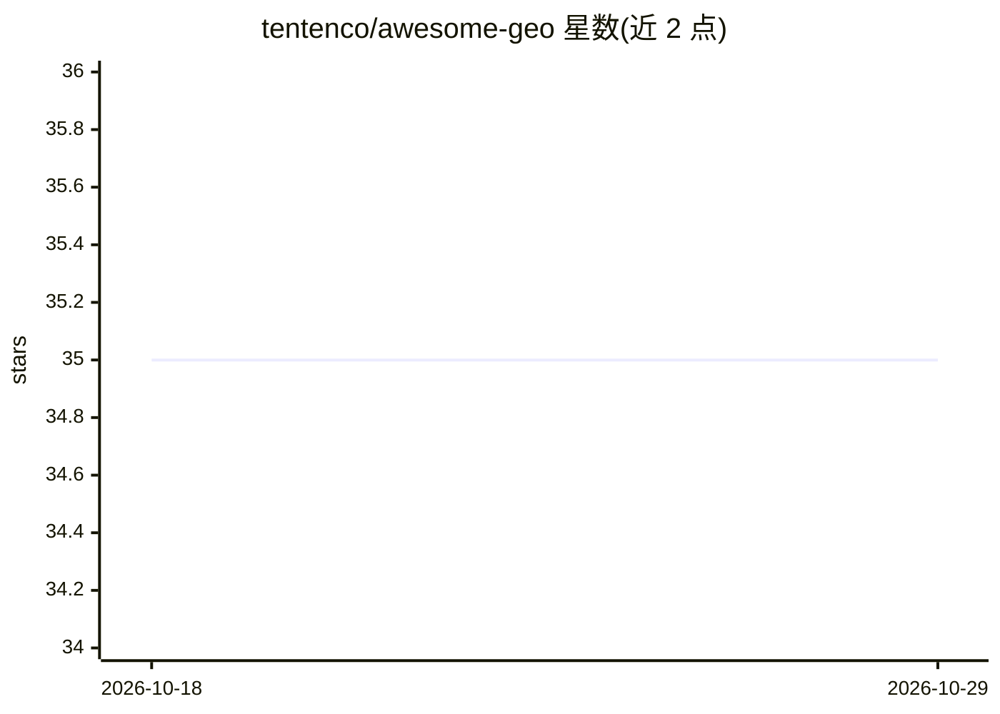

# tentenco/awesome-geo

⭐ 35 · CC0-1.0 · 推送 2026-10-07 · [GitHub](https://github.com/tentenco/awesome-geo) · [官网](https://geo.tenten.co/) · 个人维护 · 中文 README

**社区维护的 GEO/AEO/AI 搜索可见性知识清单**

社区协作策展的证据分级指南，覆盖生成式引擎优化（GEO）、答案引擎优化（AEO）与 AI 搜索可见性的术语定义、官方平台资源、研究论文、工具地图与实操基线。条目按证据类别（官方/同行评审/预印本/独立研究/厂商报告/社区讨论）标注，收录 Google/Bing/OpenAI/Anthropic/Perplexity 官方爬虫与指南，并列出 2026 年行业时间线。以 CC0 公共领域许可发布，不排名厂商、不接受付费收录。

## 筛选速览

| 维度 | 判定 | 备注 |
|---|---|---|
| AI 角色 | `ai-knowledge` | 知识聚合/清单类 |
| 许可风险 | `viral` | CC0-1.0 |
| 部署形态 | `None` |  |
| 模型依赖 | — | README 未给出锁定关系 |
| 硬件要求 | — | 无带数字的原话,不猜 |
| 安装摩擦 | `low` | 无编译、无系统依赖或容器化 |
| 成熟度 | — | 结构信号不足 |

## 能力要点

- 按 6 类证据等级（官方/同行评审/预印本等）标注每条收录资源
- 覆盖 Google/Bing/OpenAI/Anthropic/Perplexity 官方文档与爬虫控制
- 提供工具地图（第一方、开源自托管、企业级监控）与评估清单
- 给出 7 条实操基线并展开为 30/60/90 天计划

## 适用场景

- 我要弄清 GEO、AEO、AI 搜索可见性这些术语的边界
- 为站点在 AI 搜索中的可见性寻找官方指南与工具
- 查阅 GEO 领域论文与测量方法论研究

## 场景标签

`精选清单` · 领域:学习与行业

## 证据(README 行号)

> L7: > A community-curated, evidence-aware guide to Generative Engine Optimization (GEO), Answer Engine Optimization (AEO
> L114: - **Official** — Platform, standards body, regulator, or product owner.

## 星数曲线

2026-10-18 35 → 2026-10-29 35（+0）

---
*卡片 v1 · prompt 1.4 · 生成 2026-10-25 · 置信度 high · 依据 README sha `69fd0da26122` · [字段定义](../../DATASET.md)*
