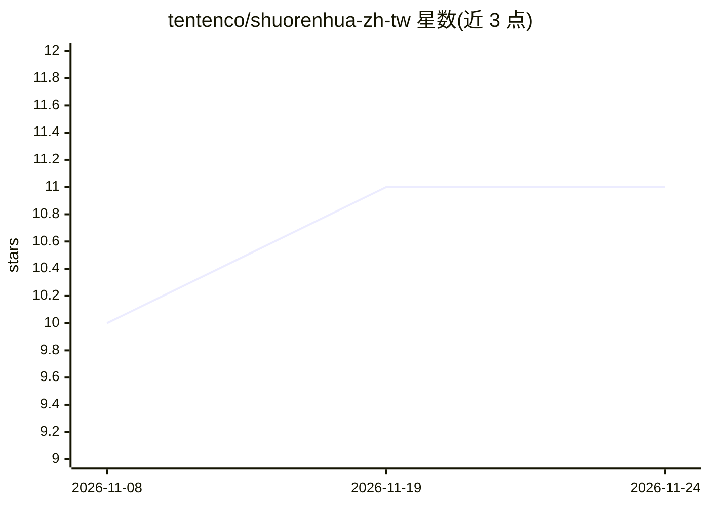

# tentenco/shuorenhua-zh-tw

⭐ 11 · MIT · 推送 2026-07-07 · [GitHub](https://github.com/tentenco/shuorenhua-zh-tw) · [官网](https://tenten.co/learning/) · 组织维护 · 中文 README

**给臺灣繁中写作者的 AI 腔清理 Skill：去 AI 味、在地化用語**

以 SKILL.md 规则文件形式分发的繁體中文（臺灣）文本清理技能，供 Claude Code、Codex、Cursor、ChatGPT 及自建 agent 加载。流程固定九步：判场景、划保护片段（数字/命令/引用原文）、臺湾化检查（150+ 条中港用语对照、简转繁错字、教育部标点）、按力度与删除范围分档、保真回读、可选 annotation mode 只标注不改稿。仅装 SKILL.md 单文件可用基础规则，完整能力需 references/ 目录。

## 筛选速览

| 维度 | 判定 | 备注 |
|---|---|---|
| AI 角色 | `ai-knowledge` | 知识聚合/清单类 |
| 许可风险 | `permissive` | MIT |
| 部署形态 | `None` |  |
| 模型依赖 | locked-api |  |
| 硬件要求 | — | 无带数字的原话,不猜 |
| 安装摩擦 | `low` | 无编译、无系统依赖或容器化 |
| 成熟度 | — | 结构信号不足 |

## 能力要点

- 九步固定流程：保护片段预检→改写→保真回读→残味二次审计
- 150+ 条臺湾用语对照与教育部标点规范，七种出版语体预设
- 长文三档 scope（structural/bounded/in-place）防止改写越改越短
- 210+ 中文短语、96 条英文短语规则与繁中评测集

## 适用场景

- AI 初稿的电子报、粉专贴文发稿前清理套话
- 客户提案/白皮书去「赋能、闭环」并补数据占位标记
- 技术文件清除简转繁残留且不改代码与命令
- 审稿时用 annotation mode 只标注问题不动稿

## 场景标签

`AI 写作` · 领域:内容生成

## 证据(README 行号)

> L3:  繁體中文（臺灣）AI 味清理 Skill —— 讓 AI 寫的稿子，讀起來像你寫的。
> L7:  給 Claude Code、Codex、Cursor、ChatGPT 和自建 agent 用的開源 Skill。
> L110: 1. 判場景：`chat / status / docs / public-writing / publishing`；命中 README、release note、論壇文、issue 回覆時，再進對應的 Scene Pack；

## 星数曲线

2026-11-08 10 → 2026-11-24 11（+1）

---
*卡片 v1 · prompt 1.4 · 生成 2026-11-19 · 置信度 high · 依据 README sha `b02bc1acd0fe` · [字段定义](../../DATASET.md)*
