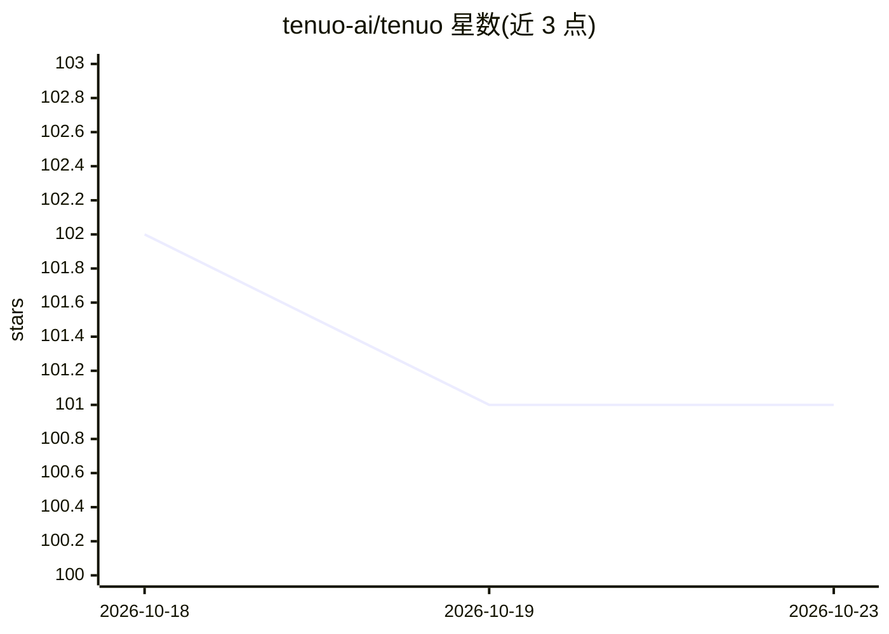

# tenuo-ai/tenuo

⭐ 101 · Rust · Apache-2.0 · 推送 2026-10-22 · [GitHub](https://github.com/tenuo-ai/tenuo) · [官网](https://tenuo.ai) · 组织维护

**面向 AI agent 的任务级密码学授权库：签名 warrant 约束工具与参数**

提供基于能力的授权系统：签发的 warrant 限定 agent 可调用的工具、参数取值范围与有效期，绑定持有者公钥；委派只能单调收缩权限（Subtractive Delegation），校验在工具执行边界本地完成（<50μs、离线可用），不询问模型，可抵御提示注入下的越权调用。可部署于进程内、MCP 服务器、API 边缘（FastAPI/网关/K8s）、Temporal 工作流或 A2A handoff。提供 Python（3.9-3.14 预编译 wheel）、Rust crate 与 Beta 的 Node.js SDK，另有 Apache-2.0 自托管 sidecar 与闭源 Beta 的 Tenuo Cloud 托管控制面。不是沙箱、不替代 IAM。

## 筛选速览

| 维度 | 判定 | 备注 |
|---|---|---|
| AI 角色 | `ai-ecosystem` | LLM/agent 周边工具 |
| 许可风险 | `permissive` | Apache-2.0 |
| 部署形态 | `self-host` | docker 或自建部署 |
| 模型依赖 | — | README 未给出锁定关系 |
| 硬件要求 | — | 无带数字的原话,不猜 |
| 安装摩擦 | `low` | 无编译、无系统依赖或容器化 |
| 成熟度 | `idea` | |

## 能力要点

- 签名 warrant 限定工具、参数约束与 TTL，绑定持有者公钥防复制重放
- 委派单调收缩：子 warrant 不得超出父级工具/约束/有效期
- 执行边界本地离线校验（<50μs），控制面宕机不影响执法
- 支持进程内、MCP、FastAPI/K8s、Temporal、A2A 多种执法点

## 适用场景

- 防止被提示注入的 agent 调用超出任务授权的工具或参数
- 多 agent 委派链中保证权限只缩不放并留签名审计凭证
- 在 MCP 工具服务器或 API 网关处对 agent 调用做授权核验

## 场景标签

`网络安全` · 领域:学习与行业

## 证据(README 行号)

> L13: Tenuo gives each task only the authority it needs. That authority travels with the work, can only shrink when hande
> L127: Tenuo is capability-based authorization. A warrant is a capability: a signed grant that lists the tools an agent m
> L177: |**Inside the agent runtime**|You own the application and want the shortest path to enforcement|Python functions, 

## 星数曲线

2026-10-18 102 → 2026-10-23 101（-1）

---
*卡片 v1 · prompt 1.4 · 生成 2026-10-23 · 置信度 high · 依据 README sha `8b284b6ff5d7` · [字段定义](../../DATASET.md)*
