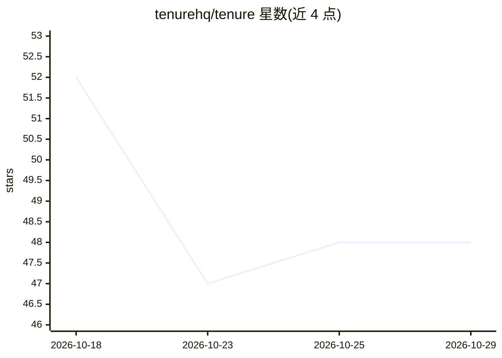

# tenurehq/tenure

⭐ 48 · TypeScript · MIT · 推送 2026-09-21 · [GitHub](https://github.com/tenurehq/tenure) · [官网](https://tenureai.dev) · 组织维护

**为 AI 客户端与 agent 提供本地共享记忆与治理代理层**

Tenure 以本地代理形式运行在 AI 客户端与上游模型之间：观察对话与工具输出，将持久决策（架构选择、编码约定、团队规则等）提取为带 scope、来源、版本与审计记录的结构化信念，并在每次请求时仅注入相关的已解析状态。提供 Document-driven/Curated/Adaptive/Reflective 四种记忆模式与 !inject off 的先观察后注入路径。支持 VS Code、Cursor、Claude Code、OpenAI 兼容客户端等接入；本地运行、无遥测、MIT 许可，另提供 Helm 团队部署。

## 筛选速览

| 维度 | 判定 | 备注 |
|---|---|---|
| AI 角色 | `ai-ecosystem` | LLM/agent 周边工具 |
| 许可风险 | `permissive` | MIT |
| 部署形态 | `library` | 以包/库形式分发 |
| 模型依赖 | — | README 未给出锁定关系 |
| 硬件要求 | — | 无带数字的原话,不猜 |
| 安装摩擦 | `low` | 无编译、无系统依赖或容器化 |
| 成熟度 | — | 结构信号不足 |

## 能力要点

- 信念带 scope 硬边界、来源、supersession 链与每轮注入日志
- 四种记忆模式，学习与注入分离，可先观察后启用注入
- 本地代理（localhost:5757），支持 OpenAI 与 Anthropic 线协议
- Linux/macOS curl 脚本、Windows PowerShell 与 Helm 三种安装途径

## 适用场景

- 让 Claude Code、Cursor、VS Code 等工具共享同一份项目决策记忆
- 隔离不同客户/项目的上下文，避免记忆越界
- 审计模型某轮回答受哪些记忆影响

## 场景标签

`Agent 记忆` · 领域:Agent 开发

## 证据(README 行号)

> L5: Tenure gives your AI clients and agents one governed memory layer between them and the upstream model.
> L47: Tenure runs as a local proxy between your AI client and the model.

## 星数曲线

2026-10-18 52 → 2026-10-29 48（-4）

---
*卡片 v1 · prompt 1.4 · 生成 2026-10-25 · 置信度 high · 依据 README sha `0c82d85e161d` · [字段定义](../../DATASET.md)*
