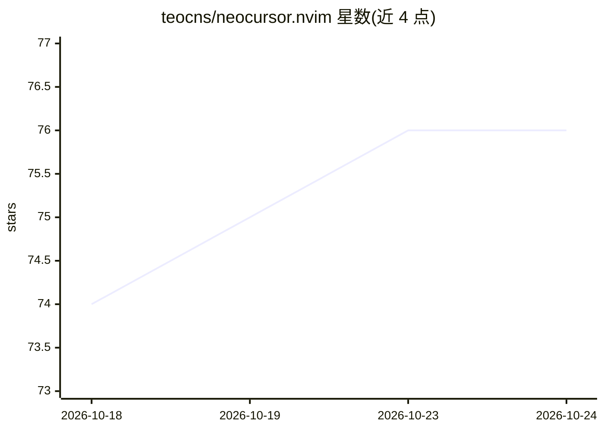

# teocns/neocursor.nvim

⭐ 76 · Lua · MIT · 推送 2026-09-02 · [GitHub](https://github.com/teocns/neocursor.nvim) · 个人维护

**Neovim 插件：复用 Cursor 账号实现 Cursor Tab 式补全**

面向 Neovim 用户的补全插件，通过 Python sidecar 读取本地已登录的 Cursor 桌面端会话，调用其 StreamCpp 后端，在 Neovim 中提供 ghost text 内联补全、整行 diff 式改写、下一次编辑预测与光标跳转（Tab-tab-tab 流程）。无需 API key，配置项均可选。要求 Neovim ≥0.10、已登录的 Cursor 客户端与 uv。项目自称 Beta，部分功能（字符级 diff、跨文件 apply）仍在开发中；声明非 Cursor 官方 affiliated，调用其私有 API 可能不符合 Cursor ToS。

## 筛选速览

| 维度 | 判定 | 备注 |
|---|---|---|
| AI 角色 | `ai-native` | 本体是模型或模型工具 |
| 许可风险 | `permissive` | MIT |
| 部署形态 | `library` | 以包/库形式分发 |
| 模型依赖 | — | README 未给出锁定关系 |
| 硬件要求 | — | 无带数字的原话,不猜 |
| 安装摩擦 | `low` | 无编译、无系统依赖或容器化 |
| 成熟度 | — | 结构信号不足 |

## 能力要点

- 复用本地 Cursor 登录会话，无需 API key 或额外订阅
- 支持 ghost text、diff 式改写、下一次编辑预测与光标跳转链
- 提供逐词接受、分级 dismiss、20 次拒绝后静默等交互细节
- 跨平台（macOS/Linux/Windows）认证路径

## 适用场景

- 在 Neovim 中使用 Cursor Tab 的预测式编辑体验
- 已有 Cursor 订阅的用户无需额外配置获得补全
- 重命名后逐一跳转并接受各处调用点的改写

## 场景标签

`代码生成` · 领域:编码与开发

## 证据(README 行号)

> L20: into Cursor, there is nothing else to set up — neocursor drives Cursor's own
> L181: neocursor doesn't reimplement or retrain a model — it *is* Cursor's Tab, reached

## 星数曲线

2026-10-18 74 → 2026-10-24 76（+2）

---
*卡片 v1 · prompt 1.4 · 生成 2026-10-24 · 置信度 mid · 依据 README sha `2fcfb114632f` · [字段定义](../../DATASET.md)*
