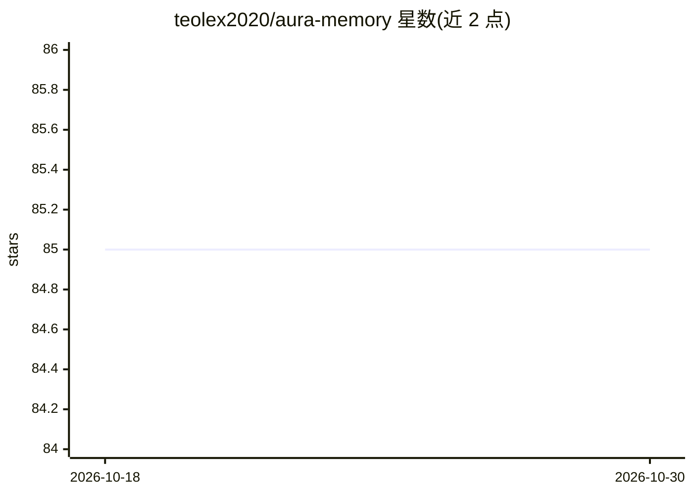

# teolex2020/aura-memory

⭐ 85 · Rust · MIT · 推送 2026-10-25 · [GitHub](https://github.com/teolex2020/aura-memory) · [官网](https://aurasdk.dev) · 组织维护

**给 AI agent 的本地认知记忆运行时：持久召回与可审计记忆**

面向 AI agent 开发者的本地认知记忆层：以纯 Rust 计算提供持久记忆存储与召回、四层认知重排（Belief/Concept/Causal/Policy）、证据与决策审计图、矛盾治理、来源（provenance）链、有界自主可塑性及生命周期维护（衰减/晋升/归档）。离线优先，不需要 LLM、embedding 或云服务，可选 ChaCha20-Poly1305 静态加密。通过 PyPI 提供 Python 包，另有 MCP HTTP/stdio 桥接使多个 AI 客户端共享同一记忆库；限制：自动文本查询从冷日志恢复不在当前 API 内，评测为开发集非竞品基准。

## 筛选速览

| 维度 | 判定 | 备注 |
|---|---|---|
| AI 角色 | `ai-ecosystem` | LLM/agent 周边工具 |
| 许可风险 | `permissive` | MIT |
| 部署形态 | `desktop` | 安装包/桌面程序 |
| 模型依赖 | — | README 未给出锁定关系 |
| 硬件要求 | — | 无带数字的原话,不猜 |
| 安装摩擦 | `low` | 无编译、无系统依赖或容器化 |
| 成熟度 | — | 结构信号不足 |

## 能力要点

- 本地 Rust 计算的记忆操作，无需 LLM/embedding API 与云服务
- 五层认知引擎与四阶段有界重排（Belief→Concept→Causal→Policy）
- 证据到决策的确定性审计图与 bitemporal 实体状态
- MCP HTTP 与 stdio 桥接，多个 AI 客户端共享同一记忆库

## 适用场景

- 让会话结束后会遗忘的 agent 拥有可审计的持久记忆
- 多个 AI 编码工具共享一份本地记忆库
- 需要来源链与矛盾治理的企业 agent 记忆管理

## 场景标签

`Agent 记忆` · 领域:Agent 开发

## 证据(README 行号)

> L20: Aura is a local cognitive runtime that runs alongside any frozen model. It gives agents durable memory, explainabil
> L54: |Memory operations|Local Rust computation; no required LLM or embedding API|

## 星数曲线

2026-10-18 85 → 2026-10-30 85（+0）

---
*卡片 v1 · prompt 1.4 · 生成 2026-10-24 · 置信度 high · 依据 README sha `7b77e0410a23` · [字段定义](../../DATASET.md)*
