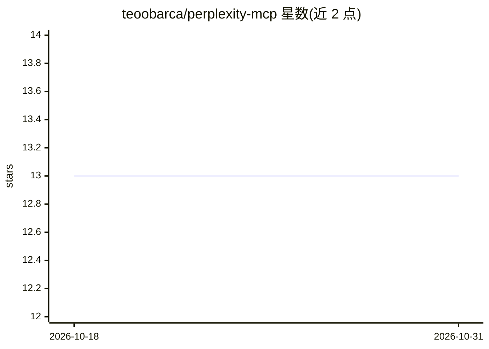

# teoobarca/perplexity-mcp

⭐ 13 · Python · MIT · 推送 2026-04-20 · [GitHub](https://github.com/teoobarca/perplexity-mcp) · 个人维护

**免 API 费用的 Perplexity MCP 服务器，带多账号池与管理面板**

面向使用 Claude Code、Cursor、Windsurf 等 MCP 客户端的开发者的 Perplexity MCP 服务器：提供 perplexity_ask 与 perplexity_research 两个工具，支持 9 种模型、web/scholar/social 多来源与深度研究模式。核心机制是以会话 Cookie 复用已有 Perplexity Pro 账号而非付费 API，多账号轮换带指数退避与三级回退，另含 React 管理面板、零成本健康检查与 Telegram 告警。限制：非官方、Cookie 约 30 天过期、匿名会话有严格限流、深度研究单次 2-5 分钟。

## 筛选速览

| 维度 | 判定 | 备注 |
|---|---|---|
| AI 角色 | `ai-ecosystem` | LLM/agent 周边工具 |
| 许可风险 | `permissive` | MIT |
| 部署形态 | `library` | 以包/库形式分发 |
| 模型依赖 | — | README 未给出锁定关系 |
| 硬件要求 | — | 无带数字的原话,不猜 |
| 安装摩擦 | `low` | 无编译、无系统依赖或容器化 |
| 成熟度 | — | 结构信号不足 |

## 能力要点

- 基于会话 Cookie 复用 Pro 账号，不调用付费 API
- 多账号 token 池：轮换、指数退避、三级回退（Pro→auto→匿名）、热重载
- React 管理面板：配额监控、令牌管理、实时日志
- 零成本健康检查（rate-limit API）与 Telegram 告警

## 适用场景

- 在 Claude Code / Cursor 等 MCP 客户端中调用 Perplexity 搜索与深度研究
- 多账号池化管理配额并在耗尽时自动回退
- 通过管理面板监控令牌状态与实时日志

## 场景标签

`语义搜索` · 领域:知识与检索

## 证据(README 行号)

> L83: claude mcp add perplexity -s user -- uv --directory /path/to/perplexity-mcp run perplexity-mcp
> L112: Two MCP tools with LLM-optimized descriptions so your AI assistant picks the right one automatically:
> L240: │  Your AI Assistant (Claude Code / Cursor / Windsurf)    │

## 星数曲线

2026-10-18 13 → 2026-10-31 13（+0）

---
*卡片 v1 · prompt 1.4 · 生成 2026-10-31 · 置信度 mid · 依据 README sha `a57230001515` · [字段定义](../../DATASET.md)*
