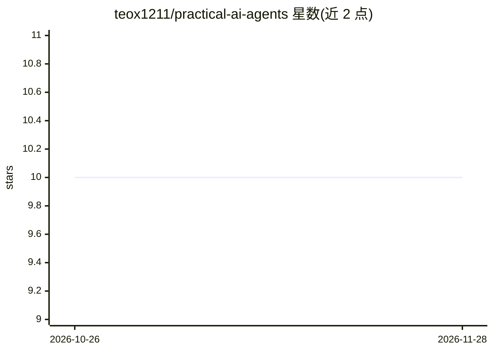

# teox1211/practical-ai-agents

⭐ 10 · 推送 2026-02-19 · [GitHub](https://github.com/teox1211/practical-ai-agents) · 个人维护

**面向研究者与开发者的开源及商业 AI agent 资源清单**

该仓库自称是一个策展型清单，收录面向现实问题的开源与商业 AI agent，并声明定期更新。README 本身不含具体条目列表，实际内容通过一个 zip 下载链接提供，且该文件由 AI 助手生成。仓库主题标签覆盖 ai-agents、llm-agents、multi-agent、machine-learning、automation 等。适合想查找 AI agent 资源的研究者、开发者与爱好者浏览，但 README 未展示清单结构与收录标准。

## 筛选速览

| 维度 | 判定 | 备注 |
|---|---|---|
| AI 角色 | `ai-knowledge` | 知识聚合/清单类 |
| 许可风险 | `none` | — |
| 部署形态 | `None` |  |
| 模型依赖 | — | README 未给出锁定关系 |
| 硬件要求 | — | 无带数字的原话,不猜 |
| 安装摩擦 | `low` | 无编译、无系统依赖或容器化 |
| 成熟度 | — | 结构信号不足 |

## 能力要点

- 收录开源与商业 AI agent 的策展清单
- 声明定期更新并接受社区贡献
- 主题标签覆盖 multi-agent、llm-agents、multi-modal-ai 等

## 适用场景

- 查找解决实际问题的 AI agent 资源
- 了解 AI agent 生态的话题分类
- 向清单提交新的 agent 项目

## 场景标签

`精选清单` · 领域:学习与行业

## 证据(README 行号)

> L3: Welcome to the **"practical-ai-agents"** repository, a curated collection of AI agents that are designed to tackle r
> L7: In this repository, you will find a diverse range of open-source and proprietary AI agents that cover a wide array o

## 星数曲线

2026-10-26 10 → 2026-11-28 10（+0）

---
*卡片 v1 · prompt 1.4 · 生成 2026-11-19 · 置信度 mid · 依据 README sha `73c41a23dc95` · [字段定义](../../DATASET.md)*
