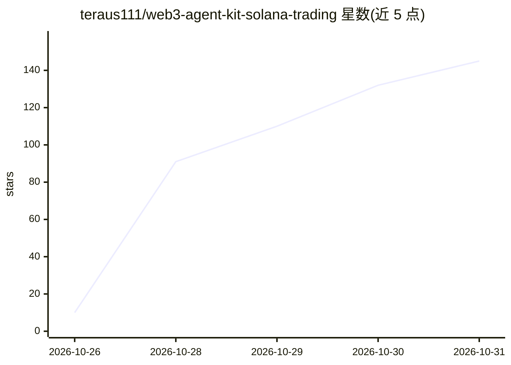

# teraus111/web3-agent-kit-solana-trading

⭐ 145 · Python · MIT · 推送 2026-10-26 · [GitHub](https://github.com/teraus111/web3-agent-kit-solana-trading) · 个人维护

**构建与区块链交互的自主 AI agent 的 Python 框架**

面向开发者的 Web3 agent 开发套件：以自然语言目标驱动 agent 在 9 条 EVM/Solana 链上执行查询余额、Uniswap 交换、跨链桥、DCA 定投、代币狙击、空投任务自动化等操作；内置 6 家 LLM 提供商级联与多 RPC 自动回退。安全机制包括 SpendGovernor 支出上限、fail-closed 预签名门与授权指纹，未绑定授权前写操作默认拒绝签名。自述为 beta 软件，各模块成熟度不一，REST API 的写路径当前不可用。提供 wak CLI、21 个示例脚本、插件系统与 REST API。

## 筛选速览

| 维度 | 判定 | 备注 |
|---|---|---|
| AI 角色 | `ai-ecosystem` | LLM/agent 周边工具 |
| 许可风险 | `permissive` | MIT |
| 部署形态 | `library` | 以包/库形式分发 |
| 模型依赖 | locked-api |  |
| 硬件要求 | — | 无带数字的原话,不猜 |
| 安装摩擦 | `low` | 无编译、无系统依赖或容器化 |
| 成熟度 | `idea` | |

## 能力要点

- 9 条 EVM/Solana 链的多链支持与自然语言目标
- 6 家 LLM 提供商级联与多 RPC 自动回退
- SpendGovernor 支出上限与 fail-closed 预签名授权机制
- 21 个示例脚本与 wak CLI（7 个命令）

## 适用场景

- 用自然语言驱动 agent 执行链上交换与查询
- 搭建 DCA 定投、代币狙击或空投自动化脚本
- 做多链投资组合跟踪与代币安全检测

## 场景标签

`Agent 框架` `金融量化` · 领域:Agent 开发

## 证据(README 行号)

> L3: > **Build autonomous AI agents that interact with blockchains — in minutes, not months.**
> L183: - 🧠 **LLM-powered reasoning** — Multi-provider cascade (OpenAI, Anthropic, Groq, DeepSeek, OpenRouter, Kimi)
> L182: - 🔗 **Multi-chain support** — Ethereum, Base, Arbitrum, Optimism, Polygon, Avalanche, BSC, Robinhood Chain, Solana

## 星数曲线

2026-10-26 10 → 2026-10-31 145（+135）

---
*卡片 v1 · prompt 1.4 · 生成 2026-10-28 · 置信度 high · 依据 README sha `d1809c7805be` · [字段定义](../../DATASET.md)*
