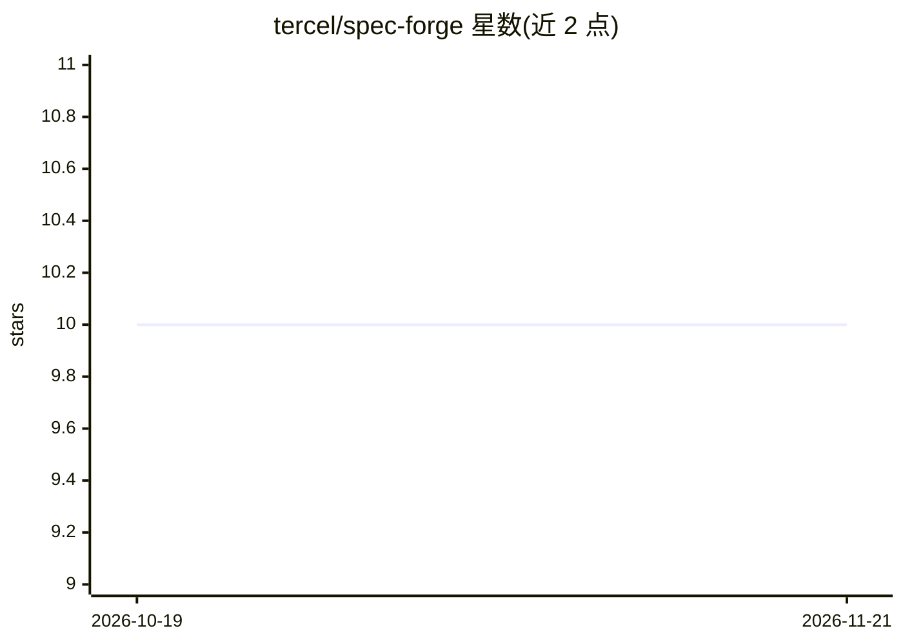

# tercel/spec-forge

⭐ 10 · Python · MIT · 推送 2026-09-16 · [GitHub](https://github.com/tercel/spec-forge) · 个人维护

**基于 Claude Code 的软件规格文档生成器**

以 Claude Code 技能形式提供的规格文档生成工具集，覆盖从头脑风暴到交付文档的流程：交互式 brainstorm、项目拆解、PRD、SRS、技术设计文档、测试用例，以及规格评审、文档审计与文档生态分析命令。模板参照 IEEE 830、ISO/IEC/IEEE 29148、Google/Amazon/Stripe 实践；支持单命令全链（Idea→Decompose→PRD→SRS→Tech Design→Review）或各命令独立使用，生成前自动扫描项目结构与既有文档。各命令也可通过别名直接调用。

## 筛选速览

| 维度 | 判定 | 备注 |
|---|---|---|
| AI 角色 | `ai-native` | 本体是模型或模型工具 |
| 许可风险 | `permissive` | MIT |
| 部署形态 | `None` |  |
| 模型依赖 | locked-api |  |
| 硬件要求 | — | 无带数字的原话,不猜 |
| 安装摩擦 | `low` | 无编译、无系统依赖或容器化 |
| 成熟度 | — | 结构信号不足 |

## 能力要点

- 10 个命令覆盖 idea、decompose、PRD、SRS、tech-design、test-cases、review、audit、analyze
- 全链模式一键运行 Idea→Decompose→PRD→SRS→Tech Design→Review 并生成需求追溯矩阵
- SRS 含范围边界、字段级输入规则、状态机、权限矩阵、错误目录与 Given/When/Then 验收标准
- 生成前自动扫描项目结构、README 与既有文档作为上下文

## 适用场景

- 把功能想法逐阶段细化为可交给实现团队的 SRS 与技术设计
- 为已有代码库做文档审计与文档与代码一致性核查
- 对文档集合做主题聚类、冲突与缺口分析

## 场景标签

`AI 写作` · 领域:内容生成

## 证据(README 行号)

> L3: **Professional Software Specification Generator for Claude Code**
> L13: |`/spec-forge:srs <name>`|**Software Requirements Specification — the delivery contract**|IEEE 830, ISO/IEC/IEEE 29

## 星数曲线

2026-10-19 10 → 2026-11-21 10（+0）

---
*卡片 v1 · prompt 1.4 · 生成 2026-11-19 · 置信度 high · 依据 README sha `5b31c7f01c63` · [字段定义](../../DATASET.md)*
