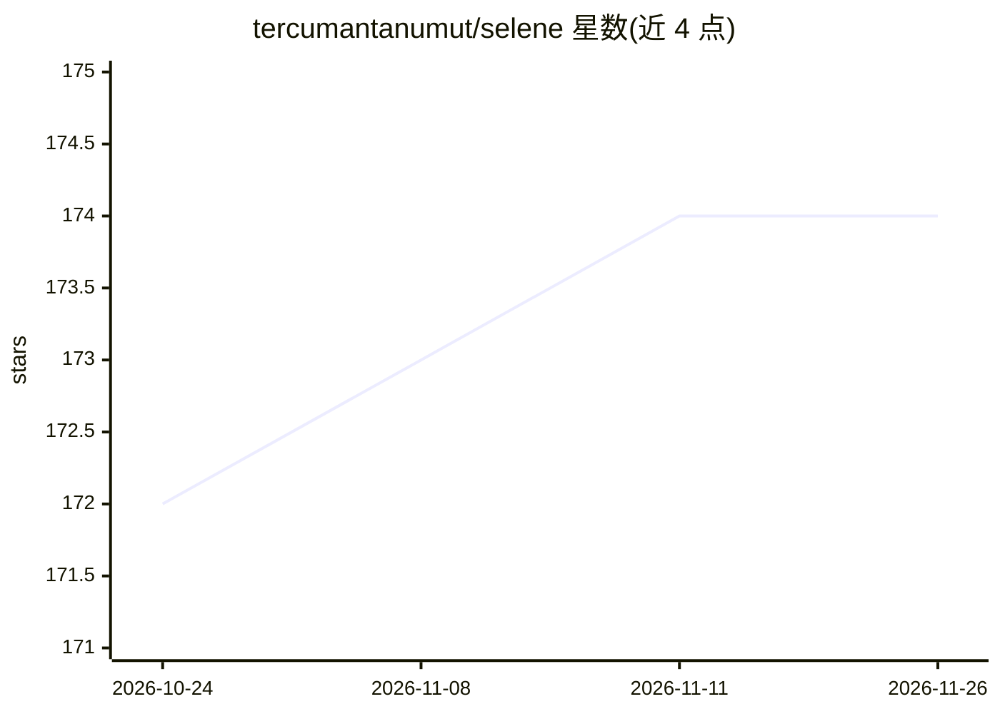

# tercumantanumut/selene

⭐ 174 · TypeScript · MIT · 推送 2026-11-17 · [GitHub](https://github.com/tercumantanumut/selene) · [官网](https://selene.engineer) · 个人维护

**本地运行 AI agent 的桌面应用，可接入聊天渠道**

Selene 是一个运行在本机的 agent 桌面应用（Electron 打包），提供聊天、代码编写、图像生成、UI 组件生成、浏览器控制与屏幕感知等 agent 能力，并以原生集成方式连接 WhatsApp、Telegram、Slack、Discord 四个渠道。检索管道先筛相关内容再交给主 agent，工具按需加载；聊天、嵌入、语音、图像均可在本地与云之间选择，支持完全离线或自带 API key。提供 macOS 签名 DMG 与 Windows 安装包/便携版。作者声明项目不再维护。

## 筛选速览

| 维度 | 判定 | 备注 |
|---|---|---|
| AI 角色 | `ai-native` | 本体是模型或模型工具 |
| 许可风险 | `permissive` | MIT |
| 部署形态 | `desktop` | 安装包/桌面程序 |
| 模型依赖 | local-ok | 支持本地模型 |
| 硬件要求 | — | 无带数字的原话,不猜 |
| 安装摩擦 | `low` | 无编译、无系统依赖或容器化 |
| 成熟度 | — | 结构信号不足 |

## 能力要点

- 每个 UI 操作同时是 agent 操作，支持中途接管或端到端运行
- 检索管道先行筛选相关内容、工具按需加载以控制上下文长度
- 本地/云端可混合选择的模型、嵌入、语音与图像生成
- Agent 驱动的嵌入式 Chromium 与多 agent 并行工作流

## 适用场景

- 把个人 agent 通过 WhatsApp/Telegram 等渠道随时对话
- 本地管理代码仓库的 git、diff 与 PR
- 用 AI 生成 React/HTML UI 组件并实时预览调整
- 定时任务结果推送到任意已连接渠道

## 场景标签

`AI 助手` `Agent 记忆` `多智能体` `工作流自动化` · 领域:Agent 开发

## 证据(README 行号)

> L9: Selene is an agent-first desktop app that runs AI on your machine. Chat, write code, generate images, design UIs, co
> L102: ## Providers
> L122: One download, no prerequisites. Selene bundles everything: Electron 41 (Chrome 146 / Node 24), local model support

## 星数曲线

2026-10-24 172 → 2026-11-26 174（+2）

---
*卡片 v1 · prompt 1.4 · 生成 2026-11-26 · 置信度 high · 依据 README sha `6723154ee3b2` · [字段定义](../../DATASET.md)*
