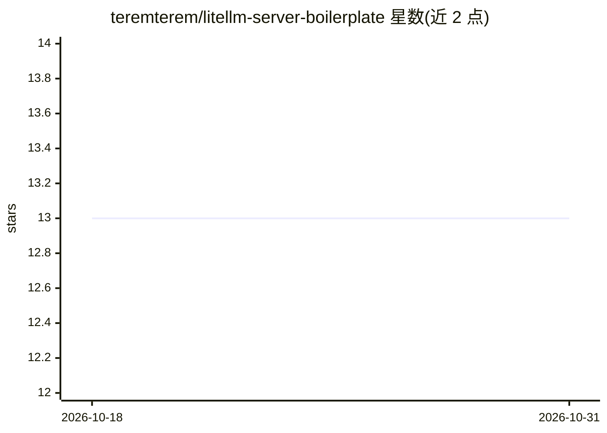

# teremterem/litellm-server-boilerplate

⭐ 13 · Python · MIT · 推送 2025-12-08 · [GitHub](https://github.com/teremterem/litellm-server-boilerplate) · 个人维护

**自托管 OpenAI/Anthropic 兼容端点的 LiteLLM 服务器模板**

预配置 uv 与 Docker 的 LiteLLM 服务器样板工程，用于自托管 OpenAI 与 Anthropic 兼容的 API 端点（默认端口 4000），可选内置 LibreChat 作为 Web UI 的快速配置。包含一个自定义 provider 示例（Yoda 风格化回复），可在此基类上实现编排多个 LLM 与工具的自定义 agent。安装流程引导用户克隆仓库、建立自己的 main 分支并指向自己的远程仓库，支持 Docker Compose 或 uv 直接运行，另含镜像发布到容器仓库的指引。运行需提供 OpenAI 等上游 provider 的 API key。

## 筛选速览

| 维度 | 判定 | 备注 |
|---|---|---|
| AI 角色 | `ai-ecosystem` | LLM/agent 周边工具 |
| 许可风险 | `permissive` | MIT |
| 部署形态 | `self-host` | docker 或自建部署 |
| 模型依赖 | — | README 未给出锁定关系 |
| 硬件要求 | — | 无带数字的原话,不猜 |
| 安装摩擦 | `low` | 无编译、无系统依赖或容器化 |
| 成熟度 | — | 结构信号不足 |

## 能力要点

- 预配置 uv 与 Docker，提供 OpenAI/Anthropic 兼容端点
- 内置 LibreChat 快速配置作为 Web UI，也可脱离其独立运行
- 自定义 provider 示例（Yoda），可扩展为编排 LLM 与工具的 agent
- 提供镜像构建并发布到 GHCR 等容器仓库的流程

## 适用场景

- 搭建自托管的 LLM API 服务器供 OpenAI/Anthropic 兼容客户端接入
- 在自有服务器上运行 LibreChat 聊天界面连接自管模型端点
- 以样板为基础开发自定义 provider（agent）并部署到 CI/CD 或 Kubernetes

## 场景标签

`模型网关` · 领域:Agent 开发

## 证据(README 行号)

> L6: **A lightweight LiteLLM server boilerplate** pre-configured with `uv` and `Docker` for hosting your own **OpenAI- an
> L13: OpenAI/Anthropic API compatible clients (LibreChat etc.)
> L15: LiteLLM Server (Port 4000)

## 星数曲线

2026-10-18 13 → 2026-10-31 13（+0）

---
*卡片 v1 · prompt 1.4 · 生成 2026-10-31 · 置信度 high · 依据 README sha `a624687f815b` · [字段定义](../../DATASET.md)*
