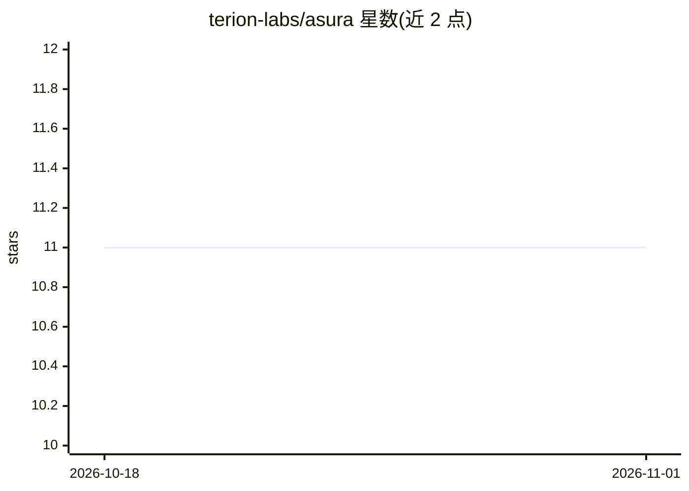

# terion-labs/asura

⭐ 11 · C# · MIT · 推送 2026-10-30 · [GitHub](https://github.com/terion-labs/asura) · [官网](https://asura.sh/) · 组织维护

**给开发者的桌面终端工作区：集成 AI agent、浏览器与开发工具面板**

基于 .NET 10 与 Avalonia 的原生桌面终端工作区，单窗口内聚合终端（Ghostty 引擎）、嵌入式 Chromium 浏览器、数据库/Redis/Docker/Kubernetes/文件/Git/进程监控等面板，各面板可通过 SSH 在本地或远程主机间切换，浏览远程 localhost 端口。内嵌在进程内运行的 AI agent：以类型化动作提案、逐项人工批准、按键即时接管的方式操作终端/浏览器/文件/数据库/K8s，支持 Anthropic、OpenAI、Ollama、OpenRouter、DeepSeek 等模型接入及 MCP 协议。当前处于早期 alpha，macOS（Apple Silicon）提供签名构建，Linux/Windows 需从源码构建。

## 筛选速览

| 维度 | 判定 | 备注 |
|---|---|---|
| AI 角色 | `ai-enhanced` | 去掉 AI 部分产品仍成立 |
| 许可风险 | `permissive` | MIT |
| 部署形态 | `None` |  |
| 模型依赖 | local-ok | 支持本地模型 |
| 硬件要求 | — | 无带数字的原话,不猜 |
| 安装摩擦 | `medium` | 含编译或系统依赖之一 |
| 成熟度 | `idea` | |

## 能力要点

- 进程内运行的 AI agent：类型化动作逐项批准，按键即撤销输入租约
- 终端/浏览器/数据库/Docker/K8s/文件/Git 等面板共享主机选择器，经 SSH 操作远程
- 支持 Anthropic/OpenAI/Ollama/OpenRouter/DeepSeek 等模型与自定义 OpenAI 兼容端点，兼容 MCP
- 凭据存于 OS 钥匙串（Keychain/DPAPI/Secret Service），agent 仅获不透明会话句柄

## 适用场景

- 在一个窗口内管理终端、远程服务器、容器与数据库
- 让 AI agent 以受控方式代为执行终端命令、浏览器操作与文件编辑
- 通过 SSH 隧道直接浏览远程服务器上的 localhost Web 应用

## 场景标签

`AI 助手` · 领域:对话与助手

## 证据(README 行号)

> L3: Asura is a native desktop terminal workspace with an integrated AI agent, embedded browser, and developer tools. One
> L5: The agent runs in-process directly inside the desktop app. There is no Electron overhead, no Node.js sidecar, and no
> L22: The agent is designed to work alongside you rather than running uncontrolled in the background:

## 星数曲线

2026-10-18 11 → 2026-11-01 11（+0）

---
*卡片 v1 · prompt 1.4 · 生成 2026-11-01 · 置信度 high · 依据 README sha `913c0a2046fa` · [字段定义](../../DATASET.md)*
