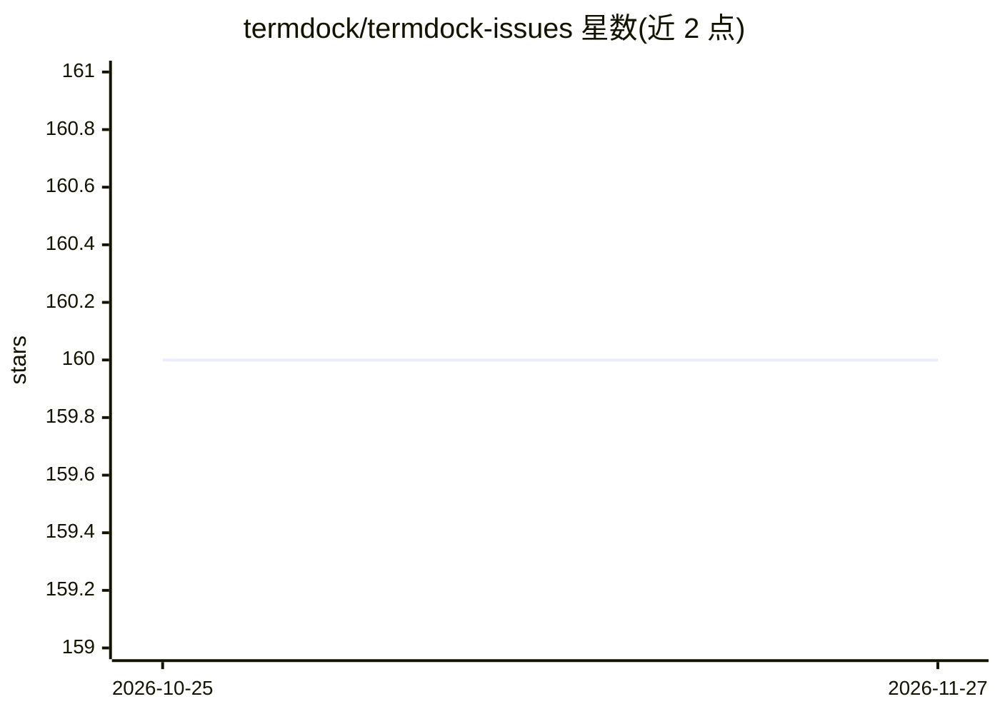

# termdock/termdock-issues

⭐ 160 · Shell · 推送 2026-11-25 · [GitHub](https://github.com/termdock/termdock-issues) · [官网](https://termdock.com) · 组织维护

**给开发者的桌面 AI 终端：并排运行多个编码 Agent**

面向 macOS 与 Windows 的桌面终端应用，将终端模拟器、AI Agent 会话、远程工作区与 Git 审查合并到一个桌面应用中。用户自行安装并登录 Claude Code、Codex、Antigravity CLI、OpenCode、GitLab Duo 等 CLI 工具，Termdock 提供并排会话管理、Workstream 审批面板、本地 HTTP Terminal API（SSE 流式输出）、macOS CLI 工具，以及基于 Rust 索引的代码图 diff 影响分析。本仓库仅提供下载、Issue 与讨论，应用本体在私有仓库开发；模型订阅需用户另行购买。

## 筛选速览

| 维度 | 判定 | 备注 |
|---|---|---|
| AI 角色 | `ai-ecosystem` | LLM/agent 周边工具 |
| 许可风险 | `none` | — |
| 部署形态 | `desktop` | 安装包/桌面程序 |
| 模型依赖 | — | README 未给出锁定关系 |
| 硬件要求 | — | 无带数字的原话,不猜 |
| 安装摩擦 | `low` | 无编译、无系统依赖或容器化 |
| 成熟度 | — | 结构信号不足 |

## 能力要点

- 并排运行 Claude Code、Codex、Antigravity CLI (agy)、OpenCode、GitLab Duo
- 本地 HTTP Terminal API 与 macOS termdock CLI，支持脚本创建/附加会话与 SSE 实时输出
- Rust 索引代码图将 git diff 映射到受影响的调用方，支持 13+ 语言的 Tree-sitter + LSP
- LAN Peer Remote 设备配对与 SSH 远程工作区，手机/浏览器可读取并输入终端

## 适用场景

- 在同一桌面工作区并排运行多个 AI 编码 Agent
- 在手机浏览器上查看终端输出并回传输入
- 接受 Agent 改动前用代码图检查 diff 影响范围
- 通过 Telegram/Discord 远程控制终端

## 场景标签

`编码 Agent` · 领域:编码与开发

## 证据(README 行号)

> L21: Termdock combines a terminal emulator, AI agent sessions, remote workspaces, and Git review in one desktop app. Use
> L66: Run supported agents such as **Claude Code, Codex, Antigravity CLI (agy), OpenCode, and GitLab Duo** in managed ter

## 星数曲线

2026-10-25 160 → 2026-11-27 160（+0）

---
*卡片 v1 · prompt 1.4 · 生成 2026-11-27 · 置信度 high · 依据 README sha `f2a86cab744a` · [字段定义](../../DATASET.md)*
