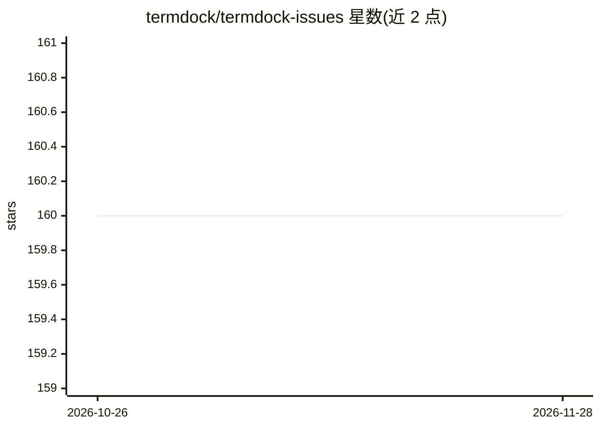

# termdock/termdock-issues

⭐ 160 · Shell · 推送 2026-11-27 · [GitHub](https://github.com/termdock/termdock-issues) · [官网](https://termdock.com) · 组织维护 · 中文 README

**给开发者的 AI 终端桌面应用：并排运行多个编程 Agent 并审查其改动**

Termdock 是一款 macOS/Windows 桌面应用，将终端模拟器、AI agent 会话、远程工作区与 Git 审查合并。用户使用自己安装的 agent CLI（模型订阅需另付），应用不附带账号。关键机制包括：会话持久化（应用退出后本地终端继续运行）、本地 HTTP Terminal API（SSE 流式输出、服务令牌鉴权）、Rust 代码图谱索引将 git diff 映射到受影响的调用方、WebGL GPU 渲染降低高输出场景的内存占用。应用本体开发在私有仓库，本仓库提供下载、问题反馈与讨论。

## 筛选速览

| 维度 | 判定 | 备注 |
|---|---|---|
| AI 角色 | `ai-ecosystem` | LLM/agent 周边工具 |
| 许可风险 | `none` | — |
| 部署形态 | `desktop` | 安装包/桌面程序 |
| 模型依赖 | — | README 未给出锁定关系 |
| 硬件要求 | — | 无带数字的原话,不猜 |
| 安装摩擦 | `low` | 无编译、无系统依赖或容器化 |
| 成熟度 | — | 结构信号不足 |

## 能力要点

- 在一个桌面工作区并排运行 Claude Code、Codex、Antigravity CLI (agy)、OpenCode、GitLab Duo 等终端 agent
- 代码图谱 + diff 影响分析：将 agent 的改动映射到受影响的调用方，Tree-sitter + LSP 覆盖 13+ 语言
- 本地与对等终端在应用退出/崩溃后继续运行；支持 SSH 远程工作区与局域网设备配对
- 手机浏览器配对读取终端输出并输入，另支持 Telegram/Discord 远程控制

## 适用场景

- 同时管理多个 AI 编程 agent 的终端会话
- 在提交前审查 agent 代码改动的影响范围
- 通过手机或 Telegram/Discord 在外查看和操控终端
- 自定义主题、字体与背景的终端工作区

## 场景标签

`编码 Agent` `代码审查` · 领域:编码与开发

## 证据(README 行号)

> L3: **An AI terminal for Claude Code, Codex, Antigravity CLI (agy), and other coding agents.**
> L21: Termdock combines a terminal emulator, AI agent sessions, remote workspaces, and Git review in one desktop app. Use
> L86: Run supported agents such as **Claude Code, Codex, Antigravity CLI (agy), OpenCode, and GitLab Duo** in managed ter

## 星数曲线

2026-10-26 160 → 2026-11-28 160（+0）

---
*卡片 v1 · prompt 1.4 · 生成 2026-11-28 · 置信度 high · 依据 README sha `8d1d07b2c2c2` · [字段定义](../../DATASET.md)*
