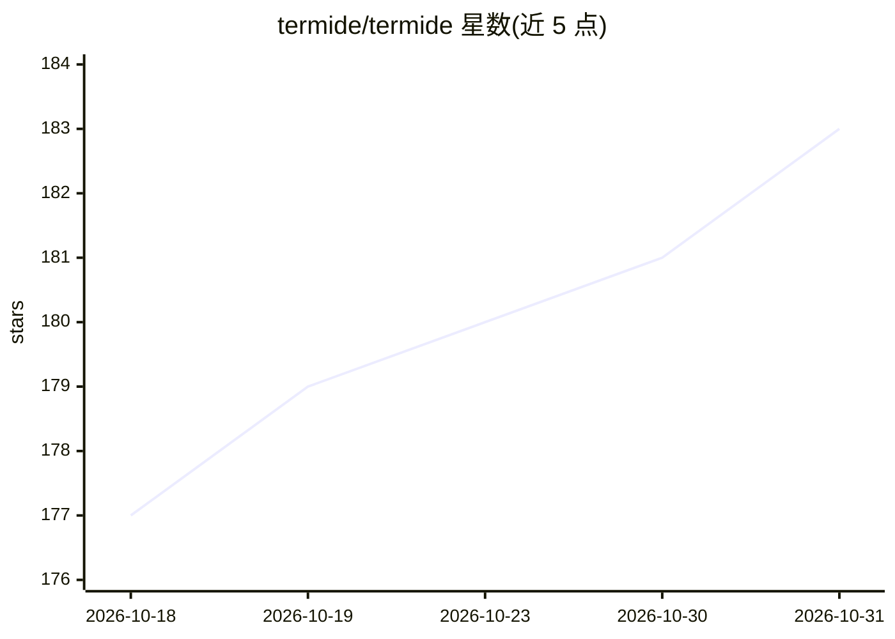

# termide/termide

⭐ 183 · Rust · MIT · 推送 2026-10-30 · [GitHub](https://github.com/termide/termide) · [官网](https://termide.github.io) · 组织维护 · 中文 README

**一体化终端工作区：编辑器/文件管理器/终端/git/数据库与编码 Agent，单一二进制**

用 Rust 编写的 TUI 应用，将代码编辑器（LSP、调试器）、双栏文件管理器（SFTP/FTP）、终端、git 面板、数据库查看器、资源监控与编码 Agent 合并在一个零配置静态二进制中，覆盖 Linux/macOS/Windows/Termux。Agent 支持任意 OpenAI 或 Anthropic 兼容端点（含 llama.cpp/Ollama/vLLM 本地运行时），可运行 Claude Code/Codex/Gemini CLI 等外部 Agent；默认不配置模型，其余功能不依赖 AI。提供 Homebrew/AUR/Nix/安装脚本及预编译包。

## 筛选速览

| 维度 | 判定 | 备注 |
|---|---|---|
| AI 角色 | `ai-enhanced` | 去掉 AI 部分产品仍成立 |
| 许可风险 | `permissive` | MIT |
| 部署形态 | `desktop` | 安装包/桌面程序 |
| 模型依赖 | local-ok | 支持本地模型 |
| 硬件要求 | — | 无带数字的原话,不猜 |
| 安装摩擦 | `low` | 无编译、无系统依赖或容器化 |
| 成熟度 | — | 结构信号不足 |

## 能力要点

- 单一静态二进制，SSH 断线后 --detached 保持工作区运行
- 编码 Agent：按工具调用授权、计划模式、MCP 服务器、headless JSON 输出
- 双栏文件管理器支持 SFTP/FTP/FTPS、压缩包内浏览、加密密码库
- 任意 OpenAI/Anthropic 兼容端点接入，含本地 llama.cpp/Ollama/vLLM

## 适用场景

- 在服务器或家用主机上用单一 TUI 完成编码、文件与运维操作
- SSH 环境断线后恢复编辑器与后台任务
- 接入本地或托管模型让 Agent 修改代码，可与其他 CLI Agent 并用

## 场景标签

`编码 Agent` · 领域:编码与开发

## 证据(README 行号)

> L33: |Built-in Coding Agent (local or hosted models)|✓|✗|plugin|✗|✗|
> L120: **Do I have to use the AI agent?** No. No provider or model is set by default, so the agent does nothing and sends

## 星数曲线

2026-10-18 177 → 2026-10-31 183（+6）

---
*卡片 v1 · prompt 1.4 · 生成 2026-10-23 · 置信度 high · 依据 README sha `5be094e05a65` · [字段定义](../../DATASET.md)*
