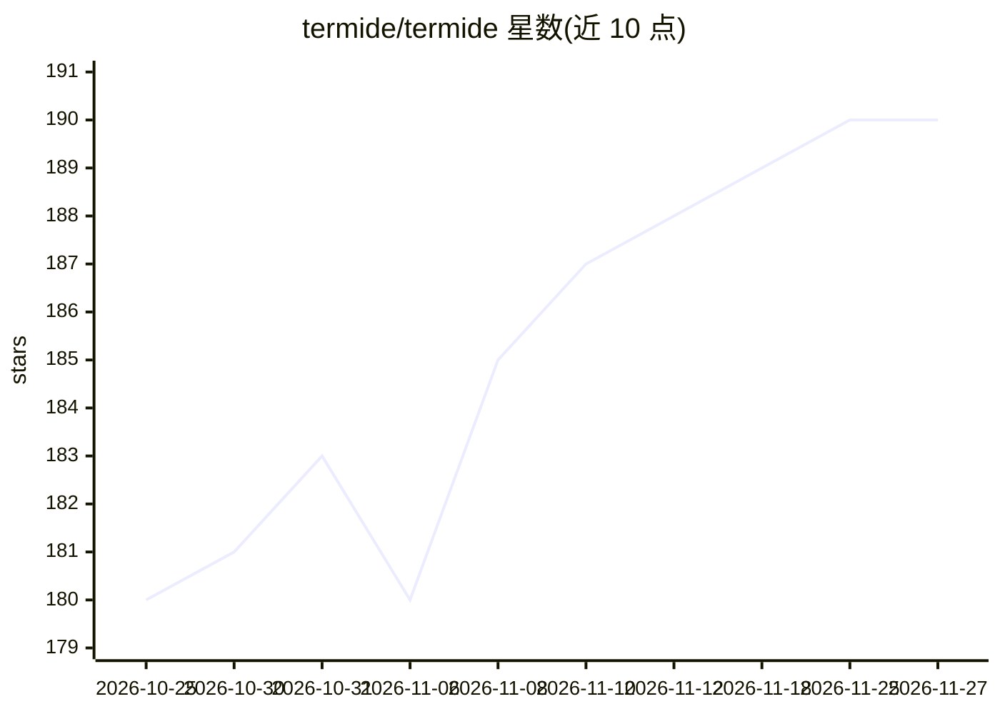

# termide/termide

⭐ 190 · Rust · MIT · 推送 2026-11-25 · [GitHub](https://github.com/termide/termide) · [官网](https://termide.github.io) · 组织维护

**面向开发者与服务器的终端一体化工作台，内置编码 Agent**

单一 Rust 静态二进制实现的终端工作台，集成 LSP 代码编辑器、双窗格文件管理器（SFTP/FTP/FTPS/SMB/NFSv3）、PTY 终端、git 面板、数据库查看器与编码 Agent。Agent 部分默认关闭，需用户自行配置模型端点（OpenAI/Anthropic 兼容接口或本地运行时），支持逐工具权限审批、检查点回退、计划模式、子代理、MCP 服务器与 `--prompt` 无头模式。无遥测，密码经加密保管库存储。

## 筛选速览

| 维度 | 判定 | 备注 |
|---|---|---|
| AI 角色 | `ai-enhanced` | 去掉 AI 部分产品仍成立 |
| 许可风险 | `permissive` | MIT |
| 部署形态 | `desktop` | 安装包/桌面程序 |
| 模型依赖 | local-ok | 支持本地模型 |
| 硬件要求 | — | 无带数字的原话,不猜 |
| 安装摩擦 | `low` | 无编译、无系统依赖或容器化 |
| 成熟度 | — | 结构信号不足 |

## 能力要点

- 编码 Agent 支持任意 OpenAI/Anthropic 兼容端点与本地运行时（llama.cpp/Ollama/vLLM）
- 支持 Claude Code/Codex/Gemini CLI 经 Agent Client Protocol 接入同一面板
- 纯 Rust 静态二进制，无运行时依赖，可在 Alpine、distroless 容器与 Termux 运行
- detached 实例使 SSH 断开后编辑器、shell 与任务保持运行

## 适用场景

- 在服务器上通过 SSH 使用一体化编辑器与文件管理器
- 在终端内让模型代为修改代码并逐步审批
- 在不可靠网络下保持远程开发工作区不中断

## 场景标签

`编码 Agent` · 领域:编码与开发

## 证据(README 行号)

> L9: An all-in-one terminal workspace for your workstation and your servers: code editor with LSP, dual-pane file manager
> L121: **Do I have to use the AI agent?** No. No provider or model is set by default, so the agent does nothing and sends
> L76: - **Bring your own model** - Any OpenAI- or Anthropic-compatible endpoint: llama.cpp, Ollama, vLLM, omlx on your ma

## 星数曲线

2026-10-25 180 → 2026-11-27 190（+10）

---
*卡片 v1 · prompt 1.4 · 生成 2026-11-26 · 置信度 high · 依据 README sha `6a4f9b7b9d15` · [字段定义](../../DATASET.md)*
