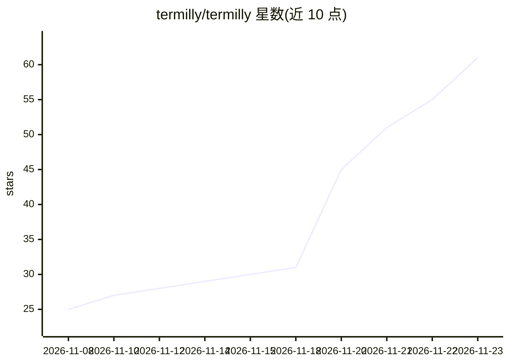

# termilly/termilly

⭐ 61 · JavaScript · Apache-2.0 · 推送 2026-11-20 · [GitHub](https://github.com/termilly/termilly) · [官网](https://termilly.com) · 个人维护

**跨平台终端管理器：分组工作区并显示编码 agent 状态**

面向 Windows/macOS/Linux 的终端应用：将终端按项目分组为工作区，重启后可恢复终端及其滚动输出（磁盘加密存储）。围绕编码 agent 提供功能：在侧栏与标题栏显示 Claude Code 和 Codex 的状态（工作中/等待/完成），终端下方显示模型、用量、费用与 git 分支；提供 agent 编辑文件的 diff 预览、逐步骤视图、任务清单（To do）、计划任务与远程访问。支持 PowerShell/cmd/Git Bash/WSL/SSH/串口等多种 shell，并提供 termilly 命令行与 MCP 供脚本和 agent 调用。去除 agent 相关功能后仍是完整的终端管理器。

## 筛选速览

| 维度 | 判定 | 备注 |
|---|---|---|
| AI 角色 | `ai-enhanced` | 去掉 AI 部分产品仍成立 |
| 许可风险 | `permissive` | Apache-2.0 |
| 部署形态 | `desktop` | 安装包/桌面程序 |
| 模型依赖 | — | README 未给出锁定关系 |
| 硬件要求 | — | 无带数字的原话,不猜 |
| 安装摩擦 | `medium` | 含编译或系统依赖之一 |
| 成熟度 | — | 结构信号不足 |

## 能力要点

- 工作区重启恢复终端及滚动输出（加密存储，可保持 shell 运行）
- 侧栏显示 Claude Code/Codex 状态及模型、用量、费用、git 分支
- agent 编辑文件的实时 diff 预览与逐步骤视图
- 提供 termilly CLI 与 MCP server 供脚本和 agent 使用

## 适用场景

- 在分组工作区中并行管理多个项目和终端
- 同时跟踪多个编码 agent 的状态并在其等待时收到通知
- 重启后恢复终端现场继续工作
- 从手机或其他电脑远程访问本地终端与 agent

## 场景标签

 · 领域:开发者工具/终端

## 证据(README 行号)

> L24: - **Workspaces.** Terminals grouped by project, each with its own folder, shells and layout: tabs, splits and docke
> L26: - **Coding agents in view.** Claude Code's and Codex's state (working, waiting for you, done) shows in the sidebar 
> L34: - **Every shell.** PowerShell, cmd, Git Bash, WSL, SSH (with your `~/.ssh/config`), serial ports and network consol

## 星数曲线

2026-11-08 25 → 2026-11-23 61（+36）

---
*卡片 v1 · prompt 1.4 · 生成 2026-11-18 · 置信度 high · 依据 README sha `a6fb77a446f4` · [字段定义](../../DATASET.md)*
