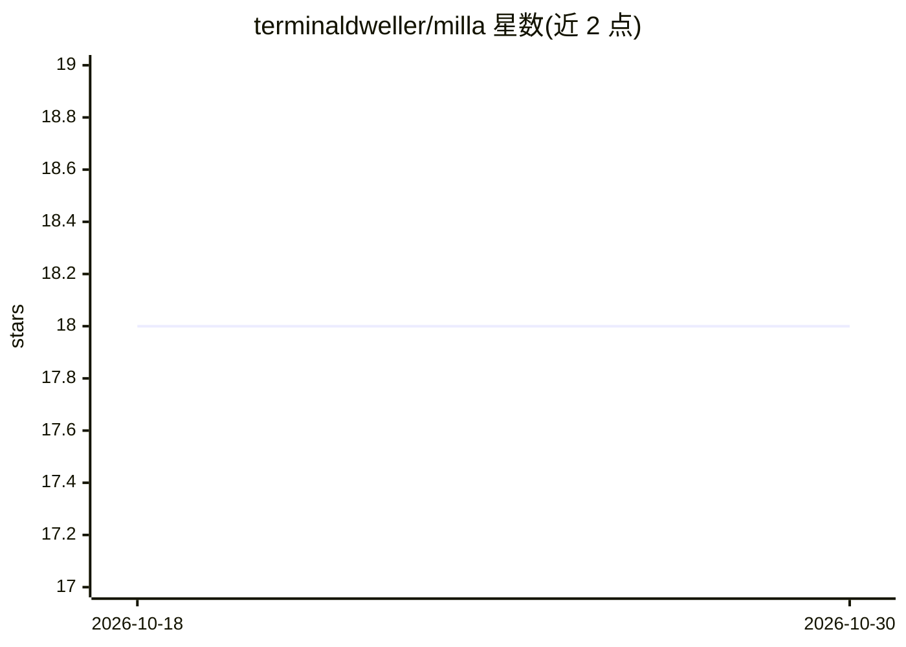

# terminaldweller/milla

⭐ 18 · Go · GPL-3.0 · 推送 2026-05-22 · [GitHub](https://github.com/terminaldweller/milla) · 个人维护

**可接入多家 LLM 的 IRC 聊天机器人**

用 Go 编写的 IRC bot：以 `botnick:` 前缀触发提问，将消息发给 LLM 并以 chroma 语法高亮打印回答；支持 Ollama、OpenAI、Gemini、OpenRouter 四种 provider，其中 Ollama 有专属采样参数（mirostat/numCtx/seed/think 等）。支持多实例各连不同 ircd、SASL/客户端证书/TLS 认证、socks5 代理（含 Tor/i2p 场景）、频道内容抓取入库并可用 SQL 自定义命令生成摘要、Lua 插件、RSS 推送、关键词 watchlist 告警，以及基于 OpenAI agents SDK 的自定义 UserAgent。配置以 TOML 文件驱动，通过命令行参数启动。

## 筛选速览

| 维度 | 判定 | 备注 |
|---|---|---|
| AI 角色 | `ai-native` | 本体是模型或模型工具 |
| 许可风险 | `viral` | GPL-3.0 |
| 部署形态 | `self-host` | docker 或自建部署 |
| 模型依赖 | local-ok | 支持本地模型 |
| 硬件要求 | — | 无带数字的原话,不猜 |
| 安装摩擦 | `low` | 无编译、无系统依赖或容器化 |
| 成熟度 | — | 结构信号不足 |

## 能力要点

- 四家 LLM provider（Ollama/OpenAI/Gemini/OpenRouter）可选
- 多实例运行，各实例独立配置与数据库
- SQL 自定义命令：查询结果作为上下文交给 LLM 生成回答
- Lua 插件系统与 OpenAI agents SDK 自定义 UserAgent

## 适用场景

- 在 IRC 频道里通过 @bot 提问获得 LLM 回答
- 抓取频道消息入库并生成摘要类自定义命令
- 通过 Lua 插件扩展 bot 功能、推送 RSS 与关键词告警

## 场景标签

`聊天机器人` · 领域:对话与助手

## 证据(README 行号)

> L5: - sends things over to an LLM when you ask it questions and prints the answer with optional syntax-highlighting.Curr
> L42: |provider|Which LLM provider to use. The supported options are: - ollama - chatgpt - gemini - openrouter|

## 星数曲线

2026-10-18 18 → 2026-10-30 18（+0）

---
*卡片 v1 · prompt 1.4 · 生成 2026-10-29 · 置信度 high · 依据 README sha `d40ccbc3b191` · [字段定义](../../DATASET.md)*
