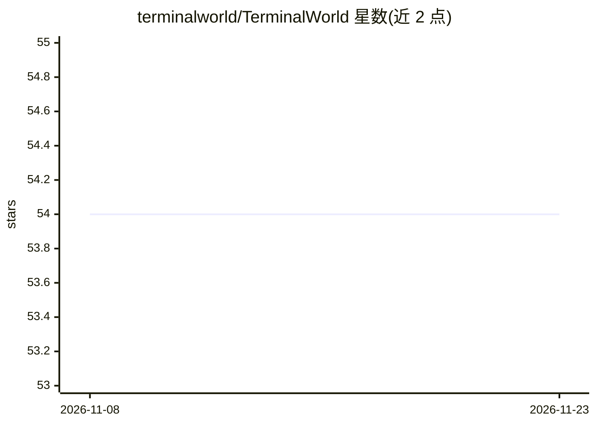

# terminalworld/TerminalWorld

⭐ 54 · Python · Apache-2.0 · 推送 2026-11-04 · [GitHub](https://github.com/terminalworld/TerminalWorld) · [官网](https://terminalworld.ai/) · 组织维护

**真实终端任务 agent 基准：从录屏逆向工程 1,530 个评测任务**

可扩展的数据引擎，从 asciinema.org 公开的 80,870 条终端录屏中自动逆向工程评测任务：四阶段流水线完成录屏收集与过滤（PII/TUI/可复现性等五准则）、LLM 合成任务指令与参考解、生成 Docker 可复现环境、基于文件系统快照生成测试断言并经三轮试炼验证，最终产出 1,530 个任务（18 类、1,280 个唯一命令），另含 200 个人工审核的 Verified 子集。供前沿模型与终端 agent 在真实工作流上做基准评测，NeurIPS 2026 数据集赛道论文。

## 筛选速览

| 维度 | 判定 | 备注 |
|---|---|---|
| AI 角色 | `ai-ecosystem` | LLM/agent 周边工具 |
| 许可风险 | `permissive` | Apache-2.0 |
| 部署形态 | `self-host` | docker 或自建部署 |
| 模型依赖 | — | README 未给出锁定关系 |
| 硬件要求 | — | 无带数字的原话,不猜 |
| 安装摩擦 | `low` | 无编译、无系统依赖或容器化 |
| 成熟度 | — | 结构信号不足 |

## 能力要点

- 80,870 条录屏经四阶段流水线产出 1,530 个验证任务
- 基于 Docker 执行的状态测试断言，经三轮试炼（可解性/非平凡性/可判别性）验证
- Verified 子集 200 任务经四位专家逐步人工审核
- 91% 命令未被 Terminal-Bench 覆盖

## 适用场景

- 评测终端 agent 在真实命令行工作流上的表现
- 获取带可执行 Docker 环境与测试套件的终端任务数据集
- 研究录屏到评测任务的自动化逆向工程流水线

## 场景标签

`模型评测` · 领域:评测与运维

## 证据(README 行号)

> L9: TerminalWorld is a scalable data engine that automatically reverse-engineers high-fidelity evaluation tasks from in-
> L97: Comprehensive benchmarking on TerminalWorld-Verified across eight frontier models and six terminal agents reveals t

## 星数曲线

2026-11-08 54 → 2026-11-23 54（+0）

---
*卡片 v1 · prompt 1.4 · 生成 2026-11-18 · 置信度 mid · 依据 README sha `5c0424b714ea` · [字段定义](../../DATASET.md)*
