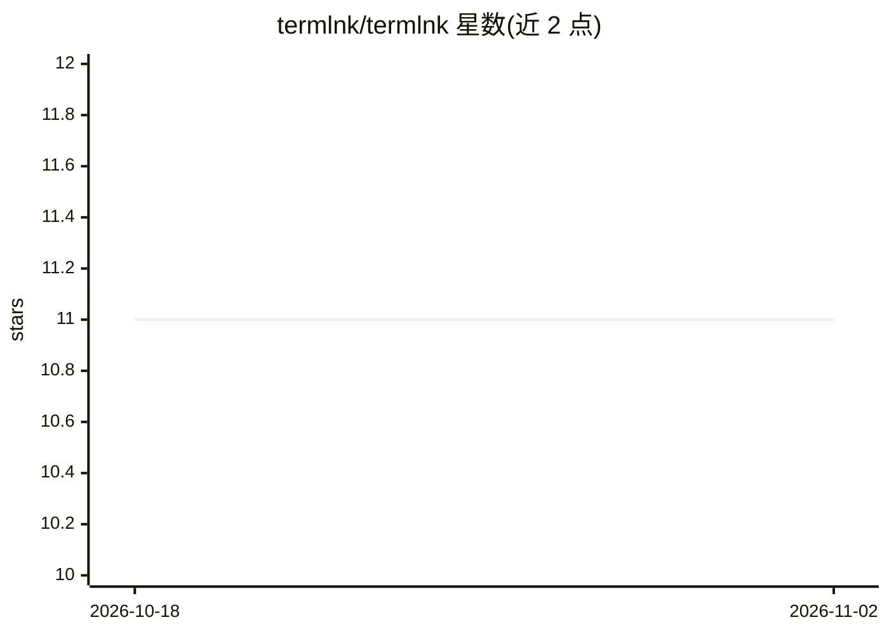

# termlnk/termlnk

⭐ 11 · TypeScript · NOASSERTION · 推送 2026-08-10 · [GitHub](https://github.com/termlnk/termlnk) · [官网](https://termlnk.com) · 组织维护 · 中文 README

**带 AI 助手的跨平台智能终端与 SSH/SFTP 客户端**

面向开发者的桌面终端应用：支持本地 shell 与 SSH 会话分屏、双栏 SFTP 浏览、端口转发/SOCKS5 代理、命令片段与跨设备端到端加密同步。内置 AI Agent 可对接 OpenAI、Claude、Gemini、DeepSeek、Qwen 或任意 OpenAI 兼容模型，经用户批准后代为执行终端命令。提供扩展市场与 TypeScript 扩展 API，桌面版覆盖 macOS/Windows/Linux，也可用 Docker 自托管浏览器版。许可为 PolyForm Noncommercial，禁止商用。

## 筛选速览

| 维度 | 判定 | 备注 |
|---|---|---|
| AI 角色 | `ai-enhanced` | 去掉 AI 部分产品仍成立 |
| 许可风险 | `none` | NOASSERTION |
| 部署形态 | `desktop` | 安装包/桌面程序 |
| 模型依赖 | locked-api |  |
| 硬件要求 | — | 无带数字的原话,不猜 |
| 安装摩擦 | `low` | 无编译、无系统依赖或容器化 |
| 成熟度 | — | 结构信号不足 |

## 能力要点

- 本地 shell 与 SSH/SFTP 多会话分屏管理
- AI Agent 支持多家模型并可经批准执行终端命令
- 71 个内置主题与扩展市场（TypeScript API）
- 一键 Docker 自托管浏览器版，数据端到端加密同步

## 适用场景

- 在一个窗口里同时管理本地终端和多台远程服务器
- 让 AI 助手按我的指令代跑命令、排查操作
- 自部署网页版终端，从任意浏览器访问工作区

## 场景标签

`AI 助手` · 领域:对话与助手

## 证据(README 行号)

> L22: Termlnk combines a fast smart terminal, an SSH &amp; SFTP client, and a built-in AI assistant that can execute comm
> L28: - 🤖 **AI Agent** — chat with OpenAI, Claude, Gemini, DeepSeek, Qwen or any OpenAI-compatible model, and switch free

## 星数曲线

2026-10-18 11 → 2026-11-02 11（+0）

---
*卡片 v1 · prompt 1.4 · 生成 2026-11-01 · 置信度 mid · 依据 README sha `caf379c18ed6` · [字段定义](../../DATASET.md)*
