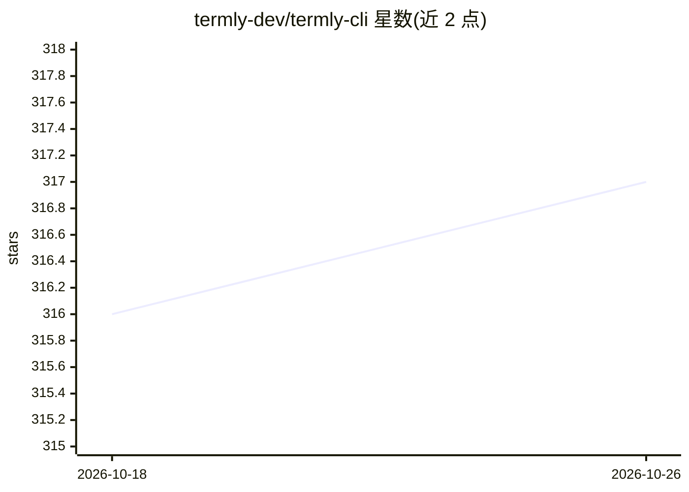

# termly-dev/termly-cli

⭐ 317 · JavaScript · MIT · 推送 2026-07-25 · [GitHub](https://github.com/termly-dev/termly-cli) · [官网](https://termly.dev) · 组织维护

**从手机远程访问终端 AI 编码助手的 CLI 通道，端到端加密**

在本地以 PTY 方式启动终端 AI 编码工具（支持 Claude Code、Aider、GitHub Copilot CLI、Gemini CLI、OpenCode、Ollama 等 23+ 种），通过 WebSocket 将加密 I/O 流转发至手机端，实现移动设备远程操控。安全机制包括 AES-256-GCM 端到端加密、DH-2048 密钥交换与指纹校验、零知识服务器；支持多会话并行、断线重连与状态同步（100KB 循环缓冲）。限制：依赖配套移动 App（标注 coming soon），服务器 URL 按环境固定不可改，每会话仅可连接一台移动设备。

## 筛选速览

| 维度 | 判定 | 备注 |
|---|---|---|
| AI 角色 | `ai-ecosystem` | LLM/agent 周边工具 |
| 许可风险 | `permissive` | MIT |
| 部署形态 | `library` | 以包/库形式分发 |
| 模型依赖 | local-ok | 支持本地模型 |
| 硬件要求 | — | 无带数字的原话,不猜 |
| 安装摩擦 | `medium` | 含编译或系统依赖之一 |
| 成熟度 | — | 结构信号不足 |

## 能力要点

- PTY 本地启动 AI 工具 + WebSocket 加密转发到移动端
- AES-256-GCM 端到端加密与 DH-2048 密钥交换、指纹校验
- 支持 23+ 种终端 AI 编码工具并自动检测
- 多会话并行运行、自动重连与状态同步

## 适用场景

- 离开电脑时用手机继续操控本地的 Claude Code/Aider 等编码会话
- 同时远程管理多个项目的 AI 编码工具实例
- 在加密保护下远程查看并输入终端 AI 工具的输出

## 场景标签

 · 领域:开发工具/AI 编码助手基础设施

## 证据(README 行号)

> L3: Access your AI coding assistants from any device. Works with Claude Code, Aider, GitHub Copilot, and any terminal-ba
> L22: - 🚀 **Universal AI Tool Support** - Works with any terminal-based AI coding assistant
> L344: Termly CLI uses a PTY (pseudo-terminal) to spawn AI tools locally and streams I/O through WebSocket with end-to-en

## 星数曲线

2026-10-18 316 → 2026-10-26 317（+1）

---
*卡片 v1 · prompt 1.4 · 生成 2026-10-21 · 置信度 mid · 依据 README sha `a4bc0fdee8a5` · [字段定义](../../DATASET.md)*
