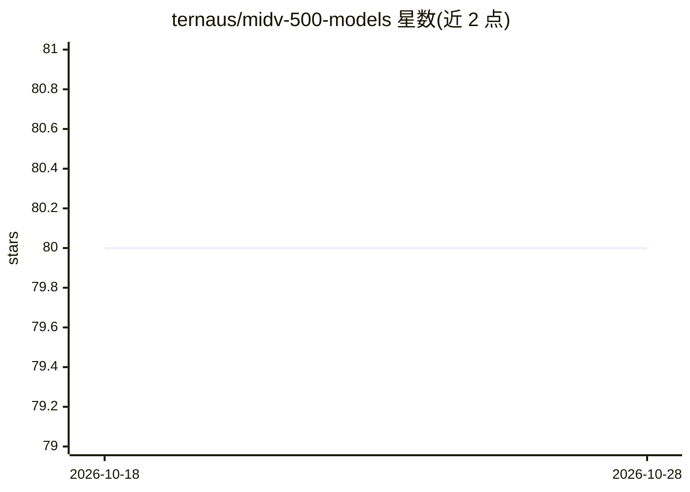

# ternaus/midv-500-models

⭐ 80 · Python · MIT · 推送 2026-02-03 · [GitHub](https://github.com/ternaus/midv-500-models) · 个人维护

**证件文档二值语义分割模型（基于 MIDV-500 数据集训练）**

提供基于 MIDV-500 数据集训练的文档二值语义分割模型：Unet 架构配 Resnet34 骨干网络，从输入图像预测文档区域的二值掩码（0 背景 / 255 文档）。以 Python 包 midv500models 形式通过 pip 安装，附 Colab 示例 notebook；包含数据集下载解压、预处理脚本、训练与推理命令及权重下载。训练数据为移动设备视频流中的身份证件数据集 MIDV-500。

## 筛选速览

| 维度 | 判定 | 备注 |
|---|---|---|
| AI 角色 | `ai-native` | 本体是模型或模型工具 |
| 许可风险 | `permissive` | MIT |
| 部署形态 | `library` | 以包/库形式分发 |
| 模型依赖 | — | README 未给出锁定关系 |
| 硬件要求 | — | 无带数字的原话,不猜 |
| 安装摩擦 | `low` | 无编译、无系统依赖或容器化 |
| 成熟度 | — | 结构信号不足 |

## 能力要点

- Unet + Resnet34 骨干的二值语义分割模型，附带权重
- 提供数据预处理、训练与推理完整脚本
- 附 Colab 示例 notebook 用于推理演示

## 适用场景

- 对证件文档图像做文档区域分割
- 在 MIDV-500 数据集上复现训练或微调模型
- 文档扫描类应用中提取文档掩码

## 场景标签

`图像视频处理` · 领域:感知与多模态

## 证据(README 行号)

> L4: The repository contains a model for binary semantic segmentation of the documents.
> L78: Unet with Resnet34 backbone: Config Weights

## 星数曲线

2026-10-18 80 → 2026-10-28 80（+0）

---
*卡片 v1 · prompt 1.4 · 生成 2026-10-24 · 置信度 high · 依据 README sha `73eaf2c21669` · [字段定义](../../DATASET.md)*
