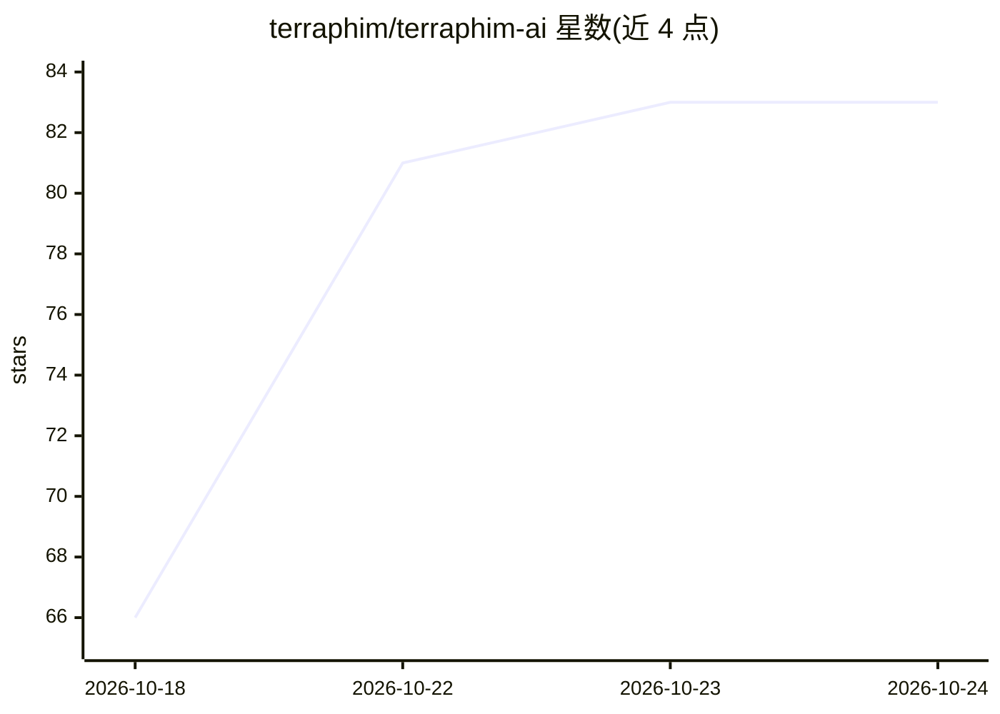

# terraphim/terraphim-ai

⭐ 83 · Rust · Apache-2.0 · 推送 2026-10-23 · [GitHub](https://github.com/terraphim/terraphim-ai) · [官网](https://terraphim.ai) · 组织维护

**本地优先的确定性 AI 助手：跨知识库语义搜索**

隐私优先、本地运行的确定性 AI 助手：将 Markdown、本地文件、StackOverflow、GitHub 等知识源（Haystack）构建为知识图谱，提供语义搜索、同义词/别名检索（synonyms:: 声明）、智能文本链接与 grep.app 跨仓库代码搜索。终端 agent 支持 OpenRouter 与 Ollama 对话、Firecracker microVM 沙箱执行三种模式、MCP Server，并可搜索 Claude Code/Cursor/Aider 会话历史。以 Rust CLI/TUI 为主，另提供 Node.js autocomplete 包、Python 文本处理库、浏览器编辑器与 VS Code/Cursor/Zed 扩展（多为预发布）。

## 筛选速览

| 维度 | 判定 | 备注 |
|---|---|---|
| AI 角色 | `ai-native` | 本体是模型或模型工具 |
| 许可风险 | `permissive` | Apache-2.0 |
| 部署形态 | `library` | 以包/库形式分发 |
| 模型依赖 | local-ok | 支持本地模型 |
| 硬件要求 | — | 无带数字的原话,不猜 |
| 安装摩擦 | `low` | 无编译、无系统依赖或容器化 |
| 成熟度 | `idea` | |

## 能力要点

- 知识图谱驱动的语义搜索与同义词别名（synonyms::）机制
- 终端 agent 支持 OpenRouter/Ollama 对话与 Firecracker microVM 沙箱三模式执行
- grep.app 集成：跨 50 万+ GitHub 仓库搜索
- 会话历史搜索：Claude Code、Cursor、Aider

## 适用场景

- 在本机统一搜索 Obsidian、Confluence、StackOverflow 等知识库
- 为 AI 编码助手的历史会话做跨工具检索
- 通过 CLI/TUI 以自然语言对话并沙箱执行操作

## 场景标签

`AI 助手` `语义搜索` `知识图谱` · 领域:对话与助手

## 证据(README 行号)

> L11: Terraphim is a privacy-first AI assistant that works for you under your complete control and is fully deterministic
> L127: Terraphim aims to bridge this gap by providing a privacy-first AI assistant that operates locally on the user's ha
> L270: - **🤖 AI Chat Integration**: OpenRouter and Ollama support for intelligent conversations

## 星数曲线

2026-10-18 66 → 2026-10-24 83（+17）

---
*卡片 v1 · prompt 1.4 · 生成 2026-10-24 · 置信度 high · 依据 README sha `33a5bab981f2` · [字段定义](../../DATASET.md)*
